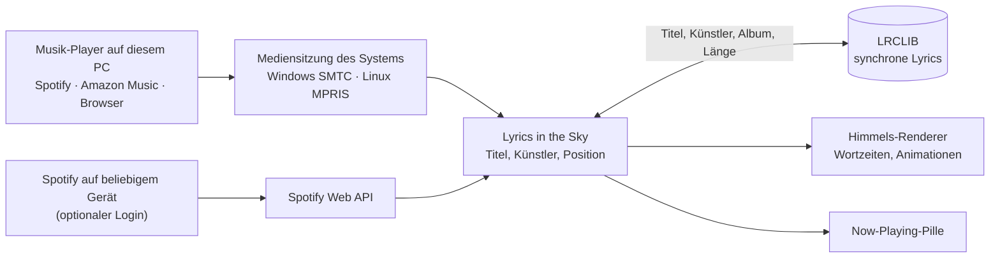

<div align="center">


# Lyrics in the Sky

**Der Song, den du gerade hörst, Wort für Wort am Minecraft-Himmel.**


**[Download auf CurseForge](https://www.curseforge.com/minecraft/mc-mods/lyrics-in-the-sky)** · [English version](README.md)


</div>

Lass auf deinem PC Musik laufen, egal ob Spotify, Amazon Music, YouTube Music oder ein anderer Player. Die
synchronisierten Songtexte erscheinen dann beim Spielen in der Welt: Wort für Wort am Himmel aufgebaut oder
als einzelne Wörter, die rund um dich schweben.

## Funktionen

- **Wort für Wort synchron.** Genaue Wortzeiten, wenn die Lyrics sie haben; sonst folgen die Wörter dem
  Tempo, in dem der Song gesungen wird. Spulen im Lied zeigt sich sofort. Mit **Wortgenau** bekommen die
  meisten Songs echte Wortzeiten von mehreren Diensten (siehe [Wortgenau](#wortgenau-optionale-inoffizielle-dienste)).
- **Am Himmel:** Wortgruppen in unterschiedlichen Größen bauen jede Zeile knapp über dem Horizont auf, auf
  versetzten, leicht ansteigenden Reihen, etwas von dir weggedreht, sodass die Zeile räumlich wirkt. Jede
  Gruppe blendet im Takt ein, die Zeile blendet weich aus, wenn die nächste woanders beginnt. Wie die Sonne
  steht sie hinter allem: Berge, Bäume, Häuser und Wolken sind davor.
- **Um dich herum:** Jedes gesungene Wort schwebt einzeln an einem festen Platz in deiner Nähe – groß,
  kursiv, leicht gedreht – und bleibt dort, während du läufst oder kämpfst, bis es nach ein paar Sekunden
  verblasst. Zum Songstart hängt eine „Now Playing“-Karte vor dir.
- **Farben nach Wahl:** Text mit Farbverlauf in Altrosa, Lavendel oder zehn weiteren Paletten (*Glas*, *Neon*,
  *Regenbogen* mit neuem Farbton für jede Zeile), je Song anders oder in deinen **eigenen vier Farben** (oben, unten,
  gesungenes Wort, Leuchten) aus dem Farbwähler; Leuchten bei Nacht, Schatten bei Tag und eine **Kontur** in jeder
  Farbe und Breite.
- **Vier Stile:** *Elegant* (die beiden Looks oben), *Natürlich 1:1* (dasselbe, als stünde es wirklich in der Welt:
  Zeilen knapp über den Hügeln, Spieler und Blöcke vor den Wörtern um dich herum, die gesungenen Wörter als
  Gruppe markiert), *Stapel* (aktuelle Zeile in der Mitte, die nächste
  schwach darunter, alles gleitet weich nach oben) und *Verspielt* (Aufploppen, Zoom, Wirbel und mehr, mit
  Funken).
- **Now-Playing-Leiste** mit aktueller Zeile und markiertem Wort, frei verschiebbar (oben oder über der Hotbar), als
  Pille, Karaoke, schlicht oder nur mit dem Titel, in deiner Größe, Rundung und Deckkraft.
- **Liquid Glass** (Standard): Leiste und Einstellungen aus mattem Glas wie bei iOS 26, mit hellem Rand und weichem
  Schatten; die Welt hinter den Einstellungen wird weichgezeichnet. *Klassisch* behält den Schwarz-Weiß-Look.
- **Vorlagen:** Standard, Himmel 1:1, Um dich 1:1, Party, Ruhig und Glas setzen den ganzen Look mit einem Klick.
- **Mitdrehen** (optional): Die Songtexte folgen deinem Blick dicht, statt stehen zu bleiben.
- **Im Takt wackeln** (optional): Jedes gesungene Wort gibt dem Text einen kleinen Kick, lange Wörter einen
  stärkeren.
- **Hinter Bergen oder immer sichtbar:** Am Himmel steht die Schrift wie die Sonne hinter Bergen, Bäumen und
  Wolken; ein Schalter holt sie vor alles.
- **Songtexte auf dem Bildschirm** als weitere Anzeige: als Untertitel, als Karaoke, das sich Wort für Wort füllt,
  oder als große Zeilen auf einer Bühne wie bei Spotify und Apple Music; unten, in der Mitte oder oben.
- **14 Vorlagen** setzen den ganzen Look mit einem Klick: Standard, Himmel 1:1, Um dich 1:1, Party, Ruhig, Glas,
  Untertitel, Karaoke, Bühne, Neon-Nacht, Regenbogen, Kino, Retro und Schlicht.
- **Das Menü auf der rechten Umschalttaste** zeigt alle Seiten und Optionen im ruhigen Look wie immer („Minimal“,
  Standard) oder als Glas-Menü: ein schwarzes Glasfenster über der weichgezeichneten
  Welt mit einer Karte für jeden Teil der Mod und Schaltern direkt auf den Karten; jede Karte öffnet eine Seite mit
  **Live-Vorschau** (ein kleiner Nachthimmel singt eine Beispielzeile in deinem Look), Abschnitten und Zeilen mit
  Schaltern, Reglern, Auswahl und Farben, „Auf Standard zurücksetzen“ je Seite und einer **Live-Ansicht**, bei der das
  Menü zur Seite tritt, während die Demo am Himmel singt. Das prachtvolle und das minimale Menü bleiben einen Klick
  entfernt (Seite *Menü*).
- **Ganz nach deinem Geschmack:** Großbuchstaben, Animationstempo, wie stark es im Takt wackelt, was bei Pause passiert
  (abdunkeln, ausblenden, weiter zeigen), die Texte weiter links oder rechts; die eigene Akzentfarbe der Leiste, eine
  Fortschrittslinie, Künstler und Equalizer an oder aus, wie das gesungene Wort markiert ist (hinterlegt, Farbe, Linie)
  und die eigene Schrift der Leiste; Akzentfarbe, Unschärfe und Animationen des Menüs.
- **Keine Anmeldung nötig** für Musik auf dem PC. **Optional Spotify-Login** für Musik vom Handy, von der
  Konsole oder einem anderen Spotify-Connect-Gerät.

<table>
<tr>
<td></td>
<td></td>
<td></td>
</tr>
<tr>
<td align="center">Am Himmel</td>
<td align="center">Um dich herum</td>
<td align="center">Einstellungen (rechte Umschalttaste)</td>
</tr>
</table>

Ganzes Vorschauvideo: [preview/lyrics-in-the-sky-preview.mp4](preview/lyrics-in-the-sky-preview.mp4)

## Voraussetzungen

| | |
|---|---|
| Minecraft | Java Edition 26.2 oder 26.3 |
| Mod-Loader | [Fabric Loader](https://fabricmc.net) 0.18.4+ (26.2) oder 0.19.3+ (26.3) und [Fabric API](https://modrinth.com/mod/fabric-api) |
| System | Windows 10/11 oder Linux mit `gdbus` (Teil von GLib, auf praktisch jedem Desktop installiert) |
| Java | 25 (bringt der Minecraft-Launcher mit) |

## Installation

1. Die Mod von [CurseForge](https://www.curseforge.com/minecraft/mc-mods/lyrics-in-the-sky) laden und `lyrics-in-the-sky-1.2.2+mc26.3.jar` (oder `…+mc26.2.jar`)
   und Fabric API in den `mods`-Ordner legen.
2. Spiel starten, Musik starten, Welt betreten.
3. Die Songtexte kommen von lrclib.net, das ist von Anfang an an. Beim ersten Mal sagt ein Hinweis im Chat,
   was gesendet wird, und bietet das Ausschalten an.
   klicken.
4. **Rechte Umschalttaste** öffnet die Einstellungen. Ohne Musik ausprobieren: dort *Demo abspielen* oder
   `/skylyrics demo`.

## Optional: Spotify verbinden

Musik auf diesem PC – Spotify, Amazon Music, Browser – läuft ohne Anmeldung. Wenn du auf dem Handy, der
Konsole oder einem anderen Gerät hörst, verbinde stattdessen dein Spotify-Konto.

Die Builds dieses Repos bringen die Client-ID der App „Lyrics in the Sky“ schon mit (`spotify_client_id` in
`gradle.properties`). Für den Besitzer der App und die bis zu fünf dort eingetragenen Personen reicht deshalb
ein Klick auf **Mit Spotify verbinden** → im Browser **Zustimmen**. Alle anderen legen eine eigene App an:

1. Das [Spotify-Entwickler-Dashboard](https://developer.spotify.com/dashboard) öffnen (der Knopf *Spotify-App
   anlegen …* in den Einstellungen tut das) und eine App anlegen. Name egal. Als Redirect-URI
   `http://127.0.0.1:43217/callback` eintragen und *Web API* ankreuzen.
2. Die **Client ID** der App in das Feld *Client-ID deiner Spotify-App* kopieren.
3. **Mit Spotify verbinden** klicken. Im Browser öffnet sich Spotifys Zustimmungsseite: falls nötig anmelden
   und **Zustimmen** klicken. Danach schreibt die Seite „verbunden“ in einen Minecraft-Abendhimmel, und der Tab kann zu.

Eine Spotify-App im Entwicklungsmodus darf nur ihr Besitzer plus bis zu fünf Personen nutzen, die du unter
*User Management* einträgst, und der Besitzer braucht Spotify Premium. Amazon Music bietet keine vergleichbare
Anmeldung für fremde Apps; es läuft weiter automatisch über die Mediensitzung auf dem PC.

## Befehle

| Befehl | Wirkung |
|---|---|
| `/skylyrics settings` | Einstellungen öffnen (wie die rechte Umschalttaste) |
| `/skylyrics status` | Song, Player, Position, Lyrics-Status, Offset und Spotify-Login |
| `/skylyrics demo` | 37 Sekunden Demo mit eigenem Text |
| `/skylyrics on` · `off` | Lyrics ein- oder ausschalten |
| `/skylyrics mode <sky\|around>` | am Himmel oder um dich herum |
| `/skylyrics offset <ms>` | Verzögerung für alle Songs ausgleichen; positiv = Lyrics früher |
| `/skylyrics songoffset <ms\|reset>` | Timing nur des laufenden Songs korrigieren; `reset` nimmt wieder die gemeinsame Korrektur |
| `/skylyrics share <on\|off>` | Timing-Korrekturen anonym teilen und die übernehmen, auf die sich andere Spieler geeinigt haben |
| `/skylyrics opacity <0.1–1>` | Deckkraft (Standard 0.82) |
| `/skylyrics scale <0.3–3>` | Textgröße |
| `/skylyrics height <10–70>` | Höhe über dem Horizont in Grad |
| `/skylyrics palette <name>` | `standard`, `rose`, `lavender`, `auto` (je Song), `aurora`, `sunset`, `gold`, `sakura`, `ocean`, `white`, `glass`, `neon` |
| `/skylyrics font <sans\|script\|minecraft>` | moderne Schrift, Handschrift oder Minecraft-Schrift |
| `/skylyrics style <elegant\|natural\|flow\|classic>` | Look: elegant, natürlich, Stapel oder verspielt |
| `/skylyrics follow <on\|off>` | neue Zeilen erscheinen dort, wo du hinschaust |
| `/skylyrics title <on\|off>` | Songtitel am Himmel beim Songwechsel |
| `/skylyrics behind <on\|off>` | Am Himmel hinter Bergen und Wolken oder vor allem |
| `/skylyrics beat <on\|off>` | Bei jedem gesungenen Wort wackeln |
| `/skylyrics along <on\|off>` | Songtexte drehen sich mit deinem Blick |
| `/skylyrics preset <standard\|sky\|around\|party\|calm\|glass>` | Ganzen Look auf einmal setzen |
| `/skylyrics hud <on\|off>` | Now-Playing-Leiste an oder aus |
| `/skylyrics bar <pill\|karaoke\|plain\|title>` | Aussehen der Leiste |
| `/skylyrics barpos <top\|bottom>` | Leiste oben oder über der Hotbar (frei verschieben mit dem Knopf „Leiste“ in den Einstellungen) |
| `/skylyrics theme <classic\|glass>` | Aussehen von Einstellungen und Leiste: Schwarz-Weiß oder Liquid Glass (Standard) |
| `/skylyrics barsize <0.75–1.5>` | Größe der Leiste |
| `/skylyrics barbg <0–1>` | Wie dicht der Hintergrund der Leiste ist |
| `/skylyrics barround <0–1>` | Ecken der Leiste, von eckig bis Kapsel |
| `/skylyrics glow <0–2>` | Leuchten bei Nacht und Schatten bei Tag um die Songtexte; über 1 mit dunkler Kontur |
| `/skylyrics lrclib <on\|off>` | Abfrage bei lrclib.net erlauben oder verbieten |
| `/skylyrics wortgenau <on\|off>` | Alle inoffiziellen Wortzeit-Dienste auf einmal („Wortgenau“, auch `grauzone`; standardmäßig aus) |
| `/skylyrics source <deezer\|lyricsplus\|netease\|kugou> <on\|off>` | Einzelne Wortzeit-Dienste |
| `/skylyrics spotify <connect\|disconnect>` | optionales Spotify-Konto verbinden oder trennen |

**Tasten** (unter *Steuerung → Lyrics in the Sky*): Einstellungen (**rechte Umschalttaste**), dazu
standardmäßig unbelegt: Lyrics ein/aus, Lyrics 100 ms früher, Lyrics 100 ms später. Läuft ein Song mit
Songtext, korrigieren die beiden Timing-Tasten nur diesen Song. Alle Einstellungen stehen auch in
`config/lyricsinthesky.json`, die Korrekturen pro Song in `config/lyricsinthesky/song-timing.json`.

## So funktioniert es



- **Was läuft gerade?** Unter Windows liest ein kleines PowerShell-Skript aus der Mod die
  Windows-Mediensitzung, unter Linux fragt die Mod MPRIS über `gdbus` ab. Zwischen den Meldungen des Players
  rechnet die Mod die Position selbst weiter, damit die Wörter im Takt bleiben.
- **Songtexte** kommen von [LRCLIB](https://lrclib.net), einer freien Datenbank für synchrone Lyrics.
  Gesendet werden nur Titel, Künstler, Album und Länge. Gefundene Songtexte bleiben in
  `config/lyricsinthesky/lyrics` (bis zu 1000 Songs), damit ein schon gehörter Song sie auch hat, wenn
  LRCLIB gerade nicht antwortet. Findet die genaue Abfrage nichts, versucht die Mod den Titel ohne
  Versionszusatz („- Remastered 2009“, „(Single Mix)“), dann eine freie Suche. Hat LRCLIB nur den Text ohne
  Zeiten, wird er über den Song verteilt (markiert mit „≈“).
- **Wortgenau (optional, standardmäßig aus):** echte Wortzeiten von inoffiziellen Diensten, siehe unten.
- **Timing pro Song:** Läuft der Text eines Songs zu früh oder zu spät, lässt er sich einzeln korrigieren. Diese
  Korrekturen werden anonym mit einem kleinen Tracker auf `henrik.click/lyrics-sync` geteilt (Quelltext in
  [`tracker/`](tracker/)): eine zufällige Kennung deiner Installation und der Song als Prüfsumme aus Künstler,
  Titel und den ersten Zeilen mit Zeiten. Haben 10 Spieler einen Song korrigiert und die meisten sind sich
  einig, gilt ihre Korrektur für alle.
- **Optionaler Spotify-Login** über Spotifys offizielle Web API mit Authorization Code + PKCE: kein
  Client-Secret, der Browser kehrt zu einer kleinen Seite zurück, die die Mod auf `127.0.0.1:43217` ausliefert,
  und die Tokens liegen in `config/lyricsinthesky/spotify.json` auf deinem PC.
- **Darstellung:** Eigene transparente Text-Pipelines mit Farbverlauf je Buchstabe. Der Himmelstext wird direkt
  nach dem Himmel gezeichnet, kamerarelativ wie die Sonne, sodass alles später Gezeichnete davor steht; die
  Wörter um dich herum stehen 5 bis 9 Blöcke entfernt fest in der Welt und werden zuletzt über allem gezeichnet.

## Wortgenau: optionale inoffizielle Dienste

LRCLIB hat meist nur Zeiten für ganze Zeilen; die Wörter dazwischen werden geschätzt. „Wortgenau“ fragt Dienste, die
jedes Wort timen. **Alle sind inoffiziell („Grauzone“):** frei erreichbar ohne Konto, Cookie oder Schlüssel, aber
nicht für fremde Apps gedacht, sie können sich jederzeit ändern oder wegfallen, und jeder ist aus, bis du ihn
einschaltest – alle auf einmal mit „Wortgenau“ (oder „Grauzone“ auf der Seite *Quellen*), einzeln dort und mit
`/skylyrics source <name> on|off`. Gefragt werden alle eingeschalteten gleichzeitig; gewertet wird in der Reihenfolge,
die in Tests am meisten Songs traf:

| Dienst | Woher die Wortzeiten stammen | Was er bekommt |
|---|---|---|
| **Deezer** | Deezers Songtexte (von Musixmatch, dieselben Zeiten wie bei Spotify), über Deezers Web-Player mit einer anonymen Sitzung, die nur im Speicher liegt | Künstler und Titel (an `api.deezer.com`), dann die Deezer-Song-ID (an `pipe.deezer.com`) |
| **LyricsPlus** | der Server der Erweiterung YouLy+, der Apple Music und QQ Music liest | Titel, Künstler, Album, Länge (an `lyricsplus.prjktla.my.id`) |
| **NetEase** | „YRC“-Songtexte von NetEase Cloud Music, auch zu vielen westlichen Songs | Künstler und Titel (an `music.163.com`) |
| **Kugou** | „KRC“-Songtexte von Kugou Music, oft dieselben wie bei QQ Music | Künstler, Titel, Länge (an `lyrics.kugou.com`) |
| **SyncLRC** | freie Lyrics-API mit Karaoke-Zeiten pro Wort, nur für Songs, die schon jemand getimt hat | Titel, Künstler, Album, Länge (an `api.synclrc.dev`) |
| **Better Lyrics** | der Server der Erweiterung [Better Lyrics](https://better-lyrics.boidu.dev/), meist Apple Musics Wortzeiten; ohne Schlüssel nur für Songs, die er schon gespeichert hat | Titel, Künstler, Album, Länge (an `api.betterlyrics.org`) |

Wortzeiten werden nur gezeigt, wenn sie zu der Aufnahme gehören, die du hörst: Die ersten Wörter jeder LRCLIB-Zeile
müssen gesungen werden, wenn die Zeile beginnt, bis auf eine gleichbleibende Verschiebung (ein längeres Intro einer
anderen Abmischung) – oder zwei Dienste, die den Song unabhängig getimt haben, müssen übereinstimmen (von Hand
gesetzte LRCLIB-Zeilen driften manchmal um eine Sekunde). Streuen LRCLIBs Zeilen nur etwas um die des Dienstes,
in derselben Reihenfolge, gelten dessen Zeiten, außer ein anderer Dienst passt genauer. Sonst werden die Wörter wie bisher geschätzt. Ergebnisse,
und „nichts gefunden“ für zwei Wochen, bleiben in `config/lyricsinthesky/lyrics`; ein Dienst, der nicht antwortet,
hat fünf Minuten Pause, sodass nichts hängt. Ohne LRCLIB-Songtext springt der erste Dienst ein, der den Song hat.

### Hörgenau: Mithören für Songs, die kein Dienst kennt (nur Windows, aus bis du es einschaltest)

Manche Songs hat niemand getimt, manche haben nirgends einen Songtext. Für die hört **Hörgenau** mit: Läuft so ein
Song von Anfang an, nimmt die Mod den Ton deines Musikprogramms auf (Windows-Audio-Loopback, nur im
Arbeitsspeicher), und lässt nach dem Song [whisper.cpp](https://github.com/ggml-org/whisper.cpp) die Wörter timen. Hat LRCLIB den Text
ohne Zeiten, wird dieser Text auf die Aufnahme gelegt; gibt es keinen, wird das Gehörte zum Songtext. Ab dem
nächsten Abspielen läuft der Song Wort für Wort. Bekommt LRCLIB später echte Zeilen, ersetzen die das Gelernte.

- **Kosten:** einmal ca. 190 MB Download (whisper.cpp von GitHub, Modell „small“ von Hugging Face, beide mit fester
  Prüfsumme), oder 574 MB für das Modell *Genau* (Whisper large-v3-turbo). Je gelerntem Song einmal etwa 1–2 Minuten
  bis zu vier CPU-Kerne mit niedriger Priorität (*Genau* etwa viermal so lange) und bis 750 MB Arbeitsspeicher in einem
  eigenen Prozess; *Leistung* wählt zwei Kerne, ein Viertel davon oder alle bis auf einen. Das Mithören selbst kostet
  kaum etwas.
- **Modelle:** *Schnell* (small) und *Genau* (large-v3-turbo), geeicht an den Songs unten: *Genau* hörte 87, 94 und
  86 % der gesungenen Wörter, wo *Schnell* 77, 92 und 80 % hörte, bei gleicher Zeitgenauigkeit.
- **Sync prüfen** (an mit Hörgenau): Ein Song, der schon Wortzeiten hat, wird einmal 50 s lang gehört, die gehörten
  Wörter werden mit den gezeigten verglichen, und wenn fast alle sagen, dass der Text um dasselbe Stück zu früh oder zu
  spät läuft, wird der Song darum verschoben – eine Quelle, die eine andere Fassung des Songs getimt hat. Live am
  gesungenen Ton gemessen kamen so zwei von zwölf Songs 0,8 und 1,1 s zu spät, die anderen lagen innerhalb einer
  Zehntelsekunde. Die Korrektur ist die eigene des Songs („Dieser Song“), ersetzt nie eine, die du gesetzt hast, und
  wird geteilt wie eine von Hand gesetzte.
- **Genauigkeit:** Gemessen an drei echten deutschen Songs mit von Hand gesetzten Zeiten aus dem Benchmark
  [JamendoLyrics](https://github.com/f90/jamendolyrics) (Rock, Pop, Rap): Die Zeilenanfänge lagen im Median 43–89 ms
  daneben, 71–88 % weniger als 200 ms und 91–100 % weniger als eine Sekunde. Über die Lautsprecher abgespielt, während
  das Spiel lief, war der Pop-Song nach 55 s gelernt, die Zeilenanfänge im Median 60 ms daneben. Stellen, die Whisper
  im ganzen Song verpasst, werden einzeln noch einmal abgehört; was es dann noch nicht versteht, wird zwischen den
  Nachbarwörtern geschätzt.
- **Nur der Player wird gehört:** Hörgenau nimmt nur den Ton des Programms auf, das den Song spielt (etwa Spotify),
  über Windows' Process Loopback (ab Windows 10 2004). Sprachchat, Videos in anderen Programmen und die Geräusche des
  Spiels bleiben draußen. Auf Windows 11 gemessen: Ein Prüfton aus einem anderen Programm war in der Aufnahme von allem
  8354 laut, in der von Spotify 12; eine Stimme, die dazwischenredete, schrieb Whisper nur aus der Aufnahme von allem
  ab. Findet Windows den Player nicht, oder bleibt sein Ton stumm, während der PC etwas spielt, nimmt Hörgenau wie
  früher alles auf. Dann gilt: Spielt ein anderer Player mit (ein Video im Browser), hört es nicht mit oder verwirft
  die Aufnahme, und Sprachchat kann es nicht unterscheiden.
- **Leise Aufnahmen, erfundene Zeilen:** Der Ton des Players allein kommt ohne das, was Windows danach noch anhebt, und
  war bis 17 dB leiser; Hörgenau macht ihn vor Whisper lauter (*Genau* hörte darin sonst nur eine erfundene Zeile,
  danach den ganzen Song). Zeilen, die Whisper aus Untertiteln erfindet („Untertitel im Auftrag des ZDF“), verwirft
  es.
- **Gelerntes gilt für alle, aber nur die Zeiten:** Hat Hörgenau einen Song auf den Text von lrclib.net gelegt, gehen
  nur die Zeiten der Wörter und ein Fingerabdruck dieses Textes an den Tracker auf henrik.click, nie der Songtext.
  Andere Spieler legen die Zeiten auf ihren eigenen Text von lrclib.net, und nur, wenn er genau derselbe ist; der
  Tracker prüft das vorher selbst bei lrclib.net. Songs, deren Text niemand hat, werden nicht geteilt. Von Anfang an
  an; „Gelerntes teilen“ auf der Seite *Hörgenau (KI)* oder `/skylyrics sharelearned off` schaltet es ab.
- **Datenschutz:** Mitgehört wird der Ton des Musikprogramms, wo das nicht geht alles, was über den
  Standardlautsprecher läuft, also auch Sprachchat, solange so ein Song läuft (und für die 50 s einer Sync-Prüfung). Die Aufnahme verlässt nie den PC und bleibt nicht auf der Platte, außer kurz als Datei für whisper.cpp,
  die gleich danach gelöscht wird. Mit „Gelerntes teilen“ gehen nur die Wortzeiten an den Tracker, kein Text.
- Einschalten auf der Seite *Hörgenau (KI)* im Menü, die auch Schritt für Schritt erklärt, was die KI tut, mit
  `/skylyrics hoergenau on` oder mit dem Knopf, den die Mod im Chat anbietet, wenn ein Song keine Wortzeiten hat. Ein kleiner Hinweis in der Ecke sagt, was es gerade tut; während
  es den laufenden Song aufnimmt, ist das Symbol der Leiste ein rotes Aufnahmelicht.

## Datenschutz und faire Nutzung

- Keine Anmeldung nötig. Der optionale Spotify-Login liest nur, was gerade läuft
  (`user-read-currently-playing`, `user-read-playback-state`), und lässt sich jederzeit trennen.
- Keine Cookies. Die inoffiziellen Wortzeit-Dienste werden nur gefragt, wenn du sie einschaltest (siehe oben),
  jeder höchstens einmal pro Sekunde und mit dem Namen der Mod als User-Agent.
- Abfragen sind von Anfang an an, beim ersten Mal mit Hinweis im Chat; abschalten in den Einstellungen oder
  mit `/skylyrics lrclib off`.
- Das Teilen von Timing-Korrekturen ist von Anfang an an, beim ersten Mal mit Hinweis im Chat; abschalten mit
  „Teilen“ in den Einstellungen oder `/skylyrics share off`, dann geht nichts an den Tracker. Der Tracker
  speichert pro Korrektur nur die Song-Prüfsumme, die Millisekunden und gesalzene Prüfsummen deiner
  Installations-Kennung und deines Netzes, keine IP-Adressen und kein Zugriffsprotokoll.
- Lyrics werden beim Abspielen geholt; gefundene bleiben auf deinem PC in `config/lyricsinthesky/lyrics`,
  den Ordner kannst du jederzeit löschen. Die Mod liefert keine Songtexte mit, und der Tracker speichert keine: Von
  Songs, die Hörgenau bei Spielern gelernt hat, kennt er nur die Wortzeiten (Song-Prüfsumme, Namen, Länge, Wortzeiten,
  Fingerabdruck des Textes, gesalzene Prüfsummen von Installations-Kennung und Netz); mit „Gelerntes teilen“ aus wird
  nichts geteilt.
- Der Streamer-Modus (`/skylyrics streamer on`) zeigt explizite Wörter in Songtexten, Titeln und Künstlern als „F***“.
- Nicht verbunden mit Mojang, Microsoft, Spotify, Amazon oder LRCLIB.

## Bekannte Grenzen

- macOS wird noch nicht unterstützt. Der Linux-Weg ist mit Beispieldaten getestet, aber noch nicht auf
  einem echten Desktop.
- Ohne Login meldet Spotify seine Position nur alle paar Sekunden; `/skylyrics offset` gleicht kleine
  Verzögerungen aus. Der Spotify-Client unter Linux meldet gar keine Position, nach dem Vorspulen ist die Zeit
  deshalb bis zum nächsten Song ungenau. Mit dem optionalen Spotify-Login ist die Position genau.
- Die eingebaute Spotify-App ist im Entwicklungsmodus: Außer ihrem Besitzer können sich nur fünf eingetragene
  Personen verbinden. Alle anderen brauchen ihre eigene Spotify-Entwickler-App (siehe oben).
- Livestreams und Videos ohne bekannte Länge bekommen keine Lyrics.
- Mit Shaderpack (Iris) wird der Text über das fertige Bild des Packs gezeichnet: Hügel, Bäume und Wände
  verdecken ihn weiter, die eigenen Wolken des Packs nicht. Getestet mit Complementary Reimagined.

## Selbst bauen

```bash
./gradlew collectJars             # Jars für beide Versionen in build/libs
./gradlew :mc26.3:runSelfTest     # Demo im Dev-Client abspielen, Screenshots speichern, beenden
./gradlew :mc26.3:runRecordPreview  # dasselbe in 1280×720, ein Bild pro Tick für ein Vorschauvideo
```

| Pfad | Inhalt |
|---|---|
| `src/` | gemeinsamer Code: Mediensitzungen, LRCLIB, Wortzeiten, Animationen, HUD, Befehle |
| `versions/26.2`, `versions/26.3` | Grafik-Anbindung pro Minecraft-Version (Mojang hat die Render-API in 26.3 umgebaut) |
| `preview/` | Vorschauvideo und Screenshots |

Regeln für Beiträge: [CONTRIBUTING.md](CONTRIBUTING.md). Versionen: [CHANGELOG.md](CHANGELOG.md).

## Lizenz

Code: [MIT](LICENSE). Schriften unter der SIL Open Font License 1.1:
[Poppins](https://fonts.google.com/specimen/Poppins) © The Poppins Project Authors
([Lizenz](src/main/resources/assets/lyricsinthesky/font/poppins-ofl.txt)) und
[Kalam](https://fonts.google.com/specimen/Kalam) © Indian Type Foundry
([Lizenz](src/main/resources/assets/lyricsinthesky/font/ofl.txt)).
