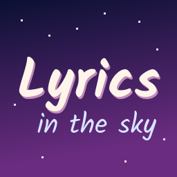
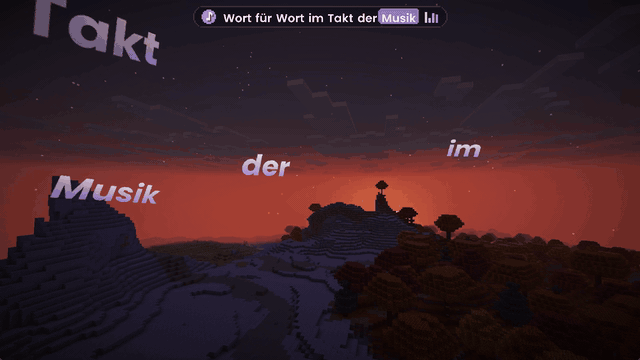
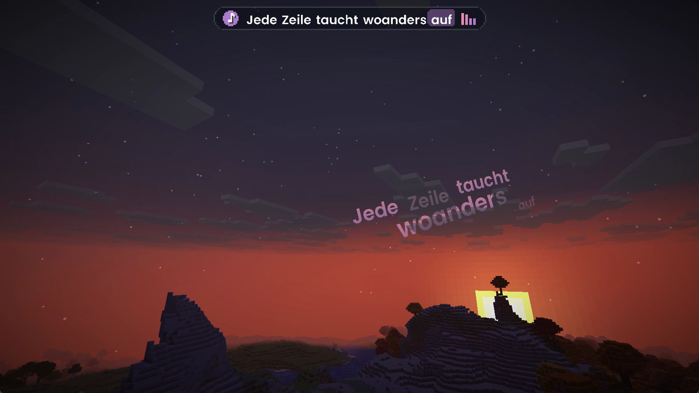
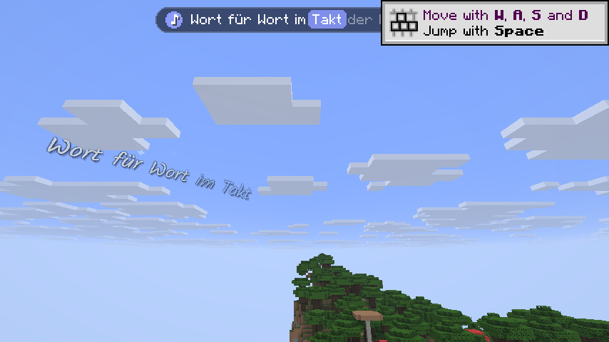
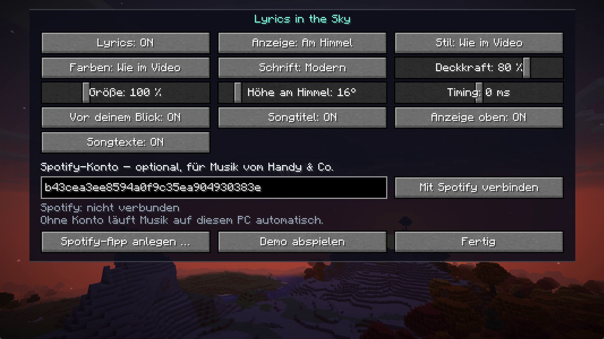
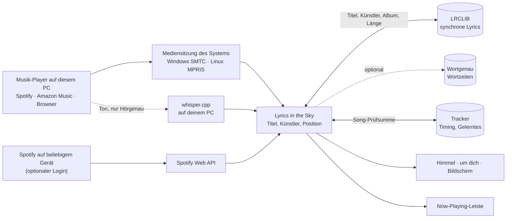

<div align="center">



# Lyrics in the Sky

**Der Song, den du gerade hörst, Wort für Wort am Minecraft-Himmel.**


**[Neueste Version herunterladen](https://github.com/Henner4746/lyrics-in-the-sky/releases/latest)** ·
[Quellen](#quellen-alles-womit-die-mod-spricht) · [English version](README.md)



</div>

Lass auf deinem PC Musik laufen, egal ob Spotify, Amazon Music, YouTube Music oder ein anderer Player. Die
synchronisierten Songtexte erscheinen dann beim Spielen in der Welt: Wort für Wort am Himmel aufgebaut, als einzelne
Wörter, die rund um dich schweben, oder auf dem Bildschirm in elf Looks.

## Funktionen

### Wo die Songtexte erscheinen

- **Am Himmel:** Wortgruppen in unterschiedlichen Größen bauen jede Zeile knapp über dem Horizont auf, auf
  versetzten, leicht ansteigenden Reihen, etwas von dir weggedreht, sodass die Zeile räumlich wirkt. Jede
  Gruppe blendet im Takt ein, die Zeile blendet weich aus, wenn die nächste woanders beginnt. Wie die Sonne
  steht sie hinter allem: Berge, Bäume, Häuser und Wolken sind davor. Ein Schalter holt sie vor alles.
- **Um dich herum:** Jedes gesungene Wort schwebt einzeln an einem festen Platz in deiner Nähe – groß,
  kursiv, leicht gedreht – und bleibt dort, während du läufst oder kämpfst, bis es nach ein paar Sekunden
  verblasst. Zum Songstart hängt eine „Now Playing“-Karte vor dir.
- **Auf dem Bildschirm**, in elf Looks: als Untertitel, als Karaoke, das sich Wort für Wort füllt, als große Zeilen
  auf einer Bühne wie bei Spotify und Apple Music, nur das gesungene Wort groß („Ein Wort“), Buchstabe für Buchstabe
  getippt („Schreibmaschine“), als Nachrichtenticker („Laufband“), mit einem Ball, der von Wort zu Wort hüpft
  („Springender Ball“), als Welle, als Spalte am rechten Rand („Seitenleiste“), mit Wörtern in eigener Größe und
  Neigung („Kinetisch“) oder als Sprechblasen wie im Messenger („Chat“); unten, in der Mitte oder oben.
- **16 gemalte Himmel** hinter den Songtexten – Nordlicht, Sternenmeer, Sternnebel, Lichtshow, Feuerwerk, Gewitter,
  ein Equalizer rund um den Horizont, Retro-Sonne, Abendrot, Blütenregen, Vollmond, Ringplanet, Ereignishorizont,
  Vinyl-Mond, Pastellmorgen und Regenbogen. Sie leben mit der Musik: Lichter leuchten bei jedem gesungenen Wort auf,
  eine neue Zeile bringt Feuerwerk oder eine Sternschnuppe, starke Wörter lassen es blitzen. Alles malt die Mod selbst
  aus Rauschen, ohne Bilddateien.

### Wort für Wort synchron

- **Genaue Wortzeiten**, wenn die Lyrics sie haben; sonst folgen die Wörter dem Tempo, in dem der Song gesungen wird.
  Spulen im Lied zeigt sich sofort.
- **Wortgenau** (optional): sechs Dienste, die jedes Wort timen, für viel mehr Songs Wort für Wort
  ([Details](#wortgenau-optionale-inoffizielle-dienste)).
- **Hörgenau** (optional, Windows und Linux): eine Sprach-KI auf deinem PC timt Songs, die niemand getimt hat, und
  prüft den Sync von Songs mit Wortzeiten ([Details](#hörgenau-mithören-für-songs-die-kein-dienst-kennt)).
- **Timing pro Song** mit einem Regler oder zwei Tasten; Korrekturen, auf die sich viele Spieler geeinigt haben,
  gelten für alle.

### Dein Look

- **22 Vorlagen** setzen den ganzen Look mit einem Klick: Standard, Himmel 1:1, Um dich 1:1, Party, Ruhig, Glas,
  Untertitel, Karaoke, Bühne, Neon-Nacht, Regenbogen, Kino, Retro, Schlicht, Ein Wort, Schreibmaschine, Laufband,
  Karaoke-Ball, Welle, Seitenleiste, Kinetisch und Chat.
- **Vier Stile:** *Elegant*, *Natürlich 1:1* (als stünde es wirklich in der Welt: Zeilen knapp über den Hügeln,
  Spieler und Blöcke vor den Wörtern um dich herum), *Stapel* (aktuelle Zeile in der Mitte, die nächste schwach
  darunter, alles gleitet nach oben) und *Verspielt* (Aufploppen, Zoom, Wirbel und mehr, mit Funken).
- **Farben:** Text mit Farbverlauf in 12 Paletten (Altrosa, Lavendel, *Glas*, *Neon*, *Regenbogen* mit neuem Farbton
  für jede Zeile, …), je Song anders oder in deinen **eigenen vier Farben** (oben, unten, gesungenes Wort, Leuchten)
  aus dem Farbwähler; Leuchten bei Nacht, Schatten bei Tag und eine **Kontur** in jeder Farbe und Breite.
- **Now-Playing-Leiste** mit aktueller Zeile und markiertem Wort, als Pille, Karaoke, schlicht oder nur mit dem
  Titel; frei verschiebbar, in deiner Größe und Rundung, mit eigener Akzentfarbe, Fortschrittslinie, Künstler und
  Equalizer.
- **Liquid Glass** (Standard): Leiste und Einstellungen aus mattem Glas, die Welt hinter den Einstellungen
  weichgezeichnet. *Klassisch* behält den Schwarz-Weiß-Look.
- **Ganz nach deinem Geschmack:** Großbuchstaben, Animationstempo, Wackeln im Takt, Songtexte, die sich mit deinem
  Blick drehen, was bei Pause passiert (abdunkeln, ausblenden, weiter zeigen), die Texte weiter links oder rechts, die
  eigene Schrift der Leiste und wie das gesungene Wort markiert ist.

### Menü und Sprache

- **Das Menü auf der rechten Umschalttaste** in drei Looks mit denselben Seiten und Optionen: *Minimal* (Standard, der
  ruhige Look wie immer), *Glas* (ein schwarzes Glasfenster mit einer Karte für jeden Teil der Mod) und *Prachtvoll*
  (Glas mit Polarlicht, aufsteigenden Noten und Licht am Rand). Jede Seite hat eine **Live-Vorschau**, Optionen, die
  gerade nicht gelten, werden ausgeblendet, und die Startseite zeigt zuerst fünf Vorlagen.
- **Deutsch oder Englisch:** Beim ersten Öffnen fragt das Menü, in welcher Sprache die Mod redet; *auto* folgt dem
  Spiel.

### Außerdem

- **Keine Anmeldung nötig** für Musik auf dem PC; ein **optionaler Spotify-Login** für Musik vom Handy, von der
  Konsole oder einem anderen Spotify-Connect-Gerät.
- **Streamer-Modus** versteckt explizite Wörter in Songtexten, Titeln und Künstlern.
- **Songtexte bleiben auf deinem PC**, damit ein schon gehörter Song sie auch hat, wenn ein Dienst nicht antwortet.

<table>
<tr>
<td></td>
<td></td>
<td></td>
</tr>
<tr>
<td align="center">Am Himmel</td>
<td align="center">Um dich herum</td>
<td align="center">Einstellungen (rechte Umschalttaste)</td>
</tr>
</table>

Ganzes Vorschauvideo: [preview/lyrics-in-the-sky-preview.mp4](preview/lyrics-in-the-sky-preview.mp4)

## Voraussetzungen

| | |
|---|---|
| Minecraft | Java Edition 26.2 oder 26.3 |
| Mod-Loader | [Fabric Loader](https://fabricmc.net) 0.18.4+ (26.2) oder 0.19.3+ (26.3) und [Fabric API](https://modrinth.com/mod/fabric-api) |
| System | Windows 10/11 oder Linux mit `gdbus` (Teil von GLib, auf praktisch jedem Desktop installiert); unter macOS nur mit Spotify-Login |
| Java | 25 (bringt der Minecraft-Launcher mit) |

## Installation

1. Die neueste Version von [GitHub Releases](https://github.com/Henner4746/lyrics-in-the-sky/releases/latest) laden:
   die Jar mit `+mc26.3.jar` am Ende für Minecraft 26.3 oder `+mc26.2.jar` für 26.2. Sie zusammen mit Fabric API in
   den `mods`-Ordner legen. Die Mod ist auch bei
   [CurseForge](https://www.curseforge.com/minecraft/mc-mods/lyrics-in-the-sky) und Modrinth eingereicht; beide
   prüfen sie noch.
2. Spiel starten, Musik starten, Welt betreten.
3. Die Songtexte kommen von lrclib.net, das ist von Anfang an an. Beim ersten Mal sagt ein Hinweis im Chat,
   was gesendet wird, und bietet das Ausschalten an.
4. **Rechte Umschalttaste** öffnet die Einstellungen. Ohne Musik ausprobieren: dort *Demo abspielen* oder
   `/skylyrics demo`.

## Welches System, welcher Player

| | Windows | Linux | macOS |
|---|---|---|---|
| Musik auf diesem PC (Spotify, Amazon Music, YouTube Music im Browser, …) | ja, über die Windows-Mediensitzung | ja, über MPRIS | noch nicht |
| Spotify auf jedem Gerät, mit optionalem Login | ja | ja | ja (ungetestet) |
| Hörgenau | ja, ein Klick richtet es ein | ja, mit selbst gebautem whisper.cpp | nein |

Die Mod bringt dafür keine eigene Bibliothek mit: Unter Windows liest ein kleines PowerShell-Skript in der Mod die
Mediensitzung des Systems, dieselbe, die auch das Lautstärke-Fenster zeigt; unter Linux fragt die Mod MPRIS über
`gdbus` ab. Zwischen den Meldungen des Players rechnet die Mod die Position selbst weiter, damit die Wörter im Takt
bleiben.

## Optional: Spotify verbinden

Musik auf diesem PC – Spotify, Amazon Music, Browser – läuft ohne Anmeldung. Wenn du auf dem Handy, der
Konsole, einem anderen Gerät oder auf einem Mac hörst, verbinde stattdessen dein Spotify-Konto.

Die Builds dieses Repos bringen die Client-ID der App „Lyrics in the Sky“ schon mit (`spotify_client_id` in
`gradle.properties`). Für den Besitzer der App und die bis zu fünf dort eingetragenen Personen reicht deshalb
ein Klick auf **Mit Spotify verbinden** → im Browser **Zustimmen**. Alle anderen legen eine eigene App an:

1. Das [Spotify-Entwickler-Dashboard](https://developer.spotify.com/dashboard) öffnen (der Knopf *Spotify-App
   anlegen …* in den Einstellungen tut das) und eine App anlegen. Name egal. Als Redirect-URI
   `http://127.0.0.1:43217/callback` eintragen und *Web API* ankreuzen.
2. Die **Client ID** der App in das Feld *Client-ID deiner Spotify-App* kopieren.
3. **Mit Spotify verbinden** klicken. Im Browser öffnet sich Spotifys Zustimmungsseite: falls nötig anmelden
   und **Zustimmen** klicken. Danach schreibt die Seite „verbunden“ in einen Minecraft-Abendhimmel, und der Tab kann zu.

Eine Spotify-App im Entwicklungsmodus darf nur ihr Besitzer plus bis zu fünf Personen nutzen, die du unter
*User Management* einträgst, und der Besitzer braucht Spotify Premium. Amazon Music bietet keine vergleichbare
Anmeldung für fremde Apps; es läuft weiter automatisch über die Mediensitzung auf dem PC.

## Quellen: alles, womit die Mod spricht

Die Mod liefert keine Songtexte und außer Fabric API keine Bibliotheken mit. Alles, was sie zeigt, kommt von den
Stellen unten, und sonst wird nichts kontaktiert: keine Statistik, keine Werbung, keine Update-Abfrage.

### Auf deinem PC (nichts verlässt ihn)

| Quelle | Wofür |
|---|---|
| Windows-Mediensitzung (SMTC), gelesen von einem PowerShell-Skript aus der Mod | Titel, Künstler, Album, Länge und Position dessen, was unter Windows läuft |
| MPRIS über D-Bus, abgefragt mit `gdbus` | dasselbe unter Linux |
| Der Ton deines Musikprogramms: Windows Process Loopback, unter Linux sein PulseAudio-Kanal (`parec`) | nur für Hörgenau, solange es an ist; im Arbeitsspeicher, kurz als Datei für whisper.cpp, die gleich danach gelöscht wird |
| `config/lyricsinthesky/lyrics` | früher gefundene Songtexte und Wortzeiten, bis zu 1000 Songs |

### Online

| Dienst | Adresse | Wofür | Wann | Was er bekommt |
|---|---|---|---|---|
| [LRCLIB](https://lrclib.net) | `lrclib.net` | synchrone Songtexte (Zeilen) | von Anfang an an; `/skylyrics lrclib off` | Titel, Künstler, Album, Länge |
| Deezer | `api.deezer.com`, `auth.deezer.com`, `pipe.deezer.com` | Wortzeiten (Deezers Songtexte sind die von Musixmatch) | Wortgenau, aus bis du es einschaltest | Künstler und Titel, dann Deezers Song-ID; eine anonyme Sitzung, die nur im Speicher liegt |
| LyricsPlus | `lyricsplus.prjktla.my.id` | Wortzeiten von Apple Music und QQ Music; springt mit Zeilen ein, wenn LRCLIB keinen Text hat | Wortgenau | Titel, Künstler, Album, Länge |
| NetEase Cloud Music | `music.163.com` | Wortzeiten („YRC“) | Wortgenau | Künstler und Titel |
| Kugou Music | `lyrics.kugou.com` | Wortzeiten („KRC“) | Wortgenau | Künstler, Titel, Länge |
| SyncLRC | `api.synclrc.dev` | Wortzeiten, für Songs, die schon jemand getimt hat | Wortgenau | Titel, Künstler, Album, Länge |
| [Better Lyrics](https://better-lyrics.boidu.dev/) | `api.betterlyrics.org` | Wortzeiten, meist die von Apple Music | Wortgenau | Titel, Künstler, Album, Länge |
| Timing-Tracker ([Quelltext](https://github.com/Henner4746/lyrics-in-the-sky/tree/lyricsplus/tracker)) | `henrik.click/lyrics-sync/v1/corrections` | Timing-Korrekturen, auf die sich Spieler geeinigt haben | gefragt bei jedem Song mit Songtext; Senden von Anfang an an, `/skylyrics share off` | der Song als Prüfsumme; beim Senden deine Korrektur und eine zufällige Kennung deiner Installation |
| Gemeinsam Gelerntes (derselbe Tracker) | `henrik.click/lyrics-sync/v1/learned` | Songs, die Hörgenau bei anderen Spielern getimt hat | gefragt, bevor ein Song ohne Wortzeiten geschätzt wird; Senden nur mit Hörgenau, `/skylyrics sharelearned off` | der Song als Prüfsumme; beim Senden der Song (Künstler, Titel, Album, Länge), die Wortzeiten mit einem Fingerabdruck des Textes, der Text selbst nur bei Songs, deren Text niemand hat, und die Installations-Kennung |
| Musikkataloge | `api.deezer.com/search`, `itunes.apple.com/search` | ob etwas ein Song ist (kein Livestream, Video oder Podcast) | nur mit Hörgenau, bei Songs, deren Text niemand hat | Künstler und Titel |
| [whisper.cpp](https://github.com/ggml-org/whisper.cpp) | `github.com` (Release b5454) | das Sprach-KI-Programm für Hörgenau, Windows-Build | einmal, wenn du Hörgenau einschaltest | nichts; der Download wird gegen eine feste Prüfsumme geprüft |
| Whisper-Modell | `huggingface.co/ggerganov/whisper.cpp` | das Modell *Schnell* (small) oder *Genau* (large-v3-turbo, 574 MB) | einmal, wenn du Hörgenau einschaltest oder das Modell wechselst | nichts; gegen eine feste Prüfsumme geprüft |
| Spotify Web API | `accounts.spotify.com`, `api.spotify.com` | was auf deinem Konto läuft, auf jedem Gerät | nur, wenn du Spotify verbunden hast | die Anmeldung (Authorization Code + PKCE, kein Client-Secret) und die Frage, was gerade läuft; Rechte `user-read-currently-playing`, `user-read-playback-state` |

Die inoffiziellen Dienste werden jeder höchstens einmal pro Sekunde gefragt, mit dem Namen der Mod als User-Agent,
ohne Cookies oder Schlüssel. Ein Dienst, der nicht antwortet, hat fünf Minuten Pause.

### Danke

- [LRCLIB](https://lrclib.net) und allen, die dort Songtexte timen.
- Den Diensten hinter Wortgenau: Deezer und Musixmatch, dem LyricsPlus-Server des Projekts YouLy+ (Apple Music, QQ
  Music), NetEase Cloud Music, Kugou Music, SyncLRC und [Better Lyrics](https://better-lyrics.boidu.dev/). Keiner von
  ihnen gehört zu dieser Mod; sie nutzt, was sie offen anbieten, und nur, wenn du es einschaltest.
- [whisper.cpp](https://github.com/ggml-org/whisper.cpp) von Georgi Gerganov und Mitwirkenden (MIT) und den
  [Whisper](https://github.com/openai/whisper)-Modellen von OpenAI (MIT), die Hörgenau auf deinem PC laufen lässt.
- Dem Benchmark [JamendoLyrics](https://github.com/f90/jamendolyrics), mit dem gemessen wurde, wie genau Hörgenau ist;
  nichts davon steckt in der Mod.
- [Fabric](https://fabricmc.net) und [Fabric API](https://modrinth.com/mod/fabric-api).
- Den Schriften [Poppins](https://fonts.google.com/specimen/Poppins) und [Kalam](https://fonts.google.com/specimen/Kalam)
  (siehe [Lizenz](#lizenz)).

## Befehle

| Befehl | Wirkung |
|---|---|
| `/skylyrics settings` | Einstellungen öffnen (wie die rechte Umschalttaste) |
| `/skylyrics status` | Song, Player, Position, Lyrics-Status, Offset und Spotify-Login |
| `/skylyrics demo` | 37 Sekunden Demo mit eigenem Text |
| `/skylyrics on` · `off` | Lyrics ein- oder ausschalten |
| `/skylyrics mode <sky\|around\|screen>` | am Himmel, um dich herum oder auf dem Bildschirm |
| `/skylyrics style <elegant\|natural\|flow\|classic>` | Look: elegant, natürlich, Stapel oder verspielt |
| `/skylyrics preset <name>` | ganzen Look auf einmal setzen: `standard`, `sky`, `around`, `party`, `calm`, `glass`, `subtitle`, `karaoke`, `stage`, `neon`, `rainbow`, `cinema`, `retro`, `clean`, `word`, `typewriter`, `ticker`, `bounce`, `wave`, `sidebar`, `kinetic`, `chat` |
| `/skylyrics sky <name\|off>` | ein gemalter Himmel: `northern`, `stars`, `nebula`, `lightshow`, `fireworks`, `storm`, `equalizer`, `retro`, `afterglow`, `petals`, `fullmoon`, `ringworld`, `blackhole`, `vinyl`, `pastel`, `rainbow` |
| `/skylyrics palette <name>` | `standard`, `rose`, `lavender`, `auto` (je Song), `aurora`, `sunset`, `gold`, `sakura`, `ocean`, `white`, `glass`, `neon`, `rainbow`, `custom` |
| `/skylyrics font <sans\|script\|minecraft>` | moderne Schrift, Handschrift oder Minecraft-Schrift |
| `/skylyrics offset <ms>` | Verzögerung für alle Songs ausgleichen; positiv = Lyrics früher |
| `/skylyrics songoffset <ms\|reset>` | Timing nur des laufenden Songs korrigieren; `reset` nimmt wieder die gemeinsame Korrektur |
| `/skylyrics opacity <0.1–1>` | Deckkraft (Standard 0.82) |
| `/skylyrics scale <0.3–3>` | Textgröße |
| `/skylyrics height <10–70>` | Höhe über dem Horizont in Grad |
| `/skylyrics glow <0–2>` | Leuchten bei Nacht und Schatten bei Tag um die Songtexte; über 1 mit dunkler Kontur |
| `/skylyrics follow <on\|off>` | neue Zeilen erscheinen dort, wo du hinschaust |
| `/skylyrics along <on\|off>` | Songtexte drehen sich mit deinem Blick |
| `/skylyrics behind <on\|off>` | am Himmel hinter Bergen und Wolken oder vor allem |
| `/skylyrics beat <on\|off>` | bei jedem gesungenen Wort wackeln |
| `/skylyrics title <on\|off>` | Songtitel am Himmel beim Songwechsel |
| `/skylyrics hud <on\|off>` | Now-Playing-Leiste an oder aus |
| `/skylyrics bar <pill\|karaoke\|plain\|title>` | Aussehen der Leiste |
| `/skylyrics barpos <top\|bottom>` | Leiste oben oder über der Hotbar (frei verschieben mit dem Knopf „Leiste“ in den Einstellungen) |
| `/skylyrics barsize <0.75–1.5>` · `barbg <0–1>` · `barround <0–1>` | Größe der Leiste, wie dicht ihr Hintergrund ist, ihre Ecken |
| `/skylyrics theme <classic\|glass>` | Leiste und Einstellungen in Schwarz-Weiß oder Liquid Glass (Standard) |
| `/skylyrics menu <minimal\|glass\|fancy>` | Look des Menüs |
| `/skylyrics language <auto\|de\|en>` | die Mod auf Deutsch oder Englisch; `auto` wie das Spiel |
| `/skylyrics streamer <on\|off>` | explizite Wörter verstecken |
| `/skylyrics lrclib <on\|off>` | Abfrage bei lrclib.net erlauben oder verbieten |
| `/skylyrics wortgenau <on\|off>` | alle Wortzeit-Dienste auf einmal (auch `grauzone`; standardmäßig aus) |
| `/skylyrics source <deezer\|lyricsplus\|netease\|kugou\|synclrc\|betterlyrics> <on\|off>` | einzelne Wortzeit-Dienste |
| `/skylyrics hoergenau <on\|off>` | Hörgenau, die Sprach-KI auf deinem PC |
| `/skylyrics share <on\|off>` | Timing-Korrekturen anonym teilen |
| `/skylyrics sharelearned <on\|off>` | teilen, was Hörgenau gelernt hat |
| `/skylyrics spotify <connect\|disconnect>` | optionales Spotify-Konto verbinden oder trennen |

**Tasten** (unter *Steuerung → Lyrics in the Sky*): Einstellungen (**rechte Umschalttaste**), dazu
standardmäßig unbelegt: Lyrics ein/aus, Lyrics 100 ms früher, Lyrics 100 ms später. Läuft ein Song mit
Songtext, korrigieren die beiden Timing-Tasten nur diesen Song. Alle Einstellungen stehen auch in
`config/lyricsinthesky.json`, die Korrekturen pro Song in `config/lyricsinthesky/song-timing.json`.

## So funktioniert es



- **Songtexte** kommen von [LRCLIB](https://lrclib.net), einer freien Datenbank für synchrone Lyrics. Gefundene
  Songtexte bleiben in `config/lyricsinthesky/lyrics` (bis zu 1000 Songs), damit ein schon gehörter Song sie auch
  hat, wenn LRCLIB gerade nicht antwortet. Findet die genaue Abfrage nichts, versucht die Mod den Titel ohne
  Versionszusatz („- Remastered 2009“, „(Single Mix)“), dann eine freie Suche. Hat LRCLIB nur den Text ohne Zeiten,
  wird er über den Song verteilt (markiert mit „≈“).
- **Timing pro Song:** Läuft der Text eines Songs zu früh oder zu spät, lässt er sich einzeln korrigieren. Diese
  Korrekturen werden anonym mit einem kleinen Tracker auf `henrik.click/lyrics-sync` geteilt (Quelltext in
  [`tracker/`](https://github.com/Henner4746/lyrics-in-the-sky/tree/lyricsplus/tracker)). Was Hörgenau bei einem Spieler gemessen hat, gilt sofort für alle, solange keine andere
  Messung widerspricht; von Hand gesetzte Korrekturen gelten, wenn 10 Spieler einen Song korrigiert haben und die
  meisten sich einig sind. Die Mod fragt bei jedem Song mit Songtext nach, auch wenn du selbst nichts teilst.
- **Optionaler Spotify-Login** über Spotifys offizielle Web API mit Authorization Code + PKCE: kein
  Client-Secret, der Browser kehrt zu einer kleinen Seite zurück, die die Mod auf `127.0.0.1:43217` ausliefert,
  und die Tokens liegen in `config/lyricsinthesky/spotify.json` auf deinem PC.
- **Darstellung:** Eigene transparente Text-Pipelines mit Farbverlauf je Buchstabe. Der Himmelstext wird direkt
  nach dem Himmel gezeichnet, kamerarelativ wie die Sonne, sodass alles später Gezeichnete davor steht; die
  Wörter um dich herum stehen 5 bis 9 Blöcke entfernt fest in der Welt und werden zuletzt über allem gezeichnet. Die
  gemalten Himmel entstehen in einem Hintergrund-Thread und werden im Himmels-Durchgang auf eine Kuppel gezeichnet, vor
  den Songtexten.

## Wortgenau: optionale inoffizielle Dienste

LRCLIB hat meist nur Zeiten für ganze Zeilen; die Wörter dazwischen werden geschätzt. „Wortgenau“ fragt Dienste, die
jedes Wort timen. **Alle sind inoffiziell („Grauzone“):** frei erreichbar ohne Konto, Cookie oder Schlüssel, aber
nicht für fremde Apps gedacht, sie können sich jederzeit ändern oder wegfallen, und jeder ist aus, bis du ihn
einschaltest – alle auf einmal mit „Wortgenau“ (oder „Grauzone“ auf der Seite *Quellen*), einzeln dort und mit
`/skylyrics source <name> on|off`. Gefragt werden alle eingeschalteten gleichzeitig; gewertet wird in der Reihenfolge,
die in Tests am meisten Songs traf:

| Dienst | Woher die Wortzeiten stammen | Was er bekommt |
|---|---|---|
| **Deezer** | Deezers Songtexte (von Musixmatch, dieselben Zeiten wie bei Spotify), über Deezers Web-Player mit einer anonymen Sitzung, die nur im Speicher liegt | Künstler und Titel (an `api.deezer.com`), dann die Deezer-Song-ID (an `pipe.deezer.com`) |
| **LyricsPlus** | der Server der Erweiterung YouLy+, der Apple Music und QQ Music liest | Titel, Künstler, Album, Länge (an `lyricsplus.prjktla.my.id`) |
| **NetEase** | „YRC“-Songtexte von NetEase Cloud Music, auch zu vielen westlichen Songs | Künstler und Titel (an `music.163.com`) |
| **Kugou** | „KRC“-Songtexte von Kugou Music, oft dieselben wie bei QQ Music | Künstler, Titel, Länge (an `lyrics.kugou.com`) |
| **SyncLRC** | freie Lyrics-API mit Karaoke-Zeiten pro Wort, nur für Songs, die schon jemand getimt hat | Titel, Künstler, Album, Länge (an `api.synclrc.dev`) |
| **Better Lyrics** | der Server der Erweiterung [Better Lyrics](https://better-lyrics.boidu.dev/), meist Apple Musics Wortzeiten; ohne Schlüssel nur für Songs, die er schon gespeichert hat | Titel, Künstler, Album, Länge (an `api.betterlyrics.org`) |

Wortzeiten werden nur gezeigt, wenn sie zu der Aufnahme gehören, die du hörst: Die ersten Wörter jeder LRCLIB-Zeile
müssen gesungen werden, wenn die Zeile beginnt, bis auf eine gleichbleibende Verschiebung (ein längeres Intro einer
anderen Abmischung) – oder zwei Dienste, die den Song unabhängig getimt haben, müssen übereinstimmen (von Hand
gesetzte LRCLIB-Zeilen driften manchmal um eine Sekunde). Streuen LRCLIBs Zeilen nur etwas um die des Dienstes,
in derselben Reihenfolge, gelten dessen Zeiten, außer ein anderer Dienst passt genauer. Sonst werden die Wörter wie
bisher geschätzt. Ergebnisse, und „nichts gefunden“ für zwei Wochen, bleiben in `config/lyricsinthesky/lyrics`; ein
Dienst, der nicht antwortet, hat fünf Minuten Pause, sodass nichts hängt. Ohne LRCLIB-Songtext springt der erste
Dienst ein, der den Song mit Wortzeiten hat, sonst LyricsPlus Zeile für Zeile.

## Hörgenau: Mithören für Songs, die kein Dienst kennt

*Windows und Linux, aus bis du es einschaltest.* Manche Songs hat niemand getimt, manche haben nirgends einen
Songtext. Für die hört **Hörgenau** mit: Läuft so ein Song, nimmt die Mod den Ton deines Musikprogramms auf, wo sie
ihn noch nicht gehört hat (nur im Arbeitsspeicher). Hörst du nur einen Teil, merkt sie sich die gehörten Wörter mit
ihrer Songzeit und hört beim nächsten Mal den Rest dazu. Jedes Stück hört
[whisper.cpp](https://github.com/ggml-org/whisper.cpp); sobald gut vier Fünftel des Songs gehört sind, wird er
getimt. Hat LRCLIB den Text ohne Zeiten, wird dieser Text auf das Gehörte gelegt; gibt es keinen, wird das Gehörte zum
Songtext. Ab dem nächsten Abspielen läuft der Song Wort für Wort. Bekommt LRCLIB später echte Zeilen, ersetzen die das
Gelernte.

- **Kosten:** einmal ca. 190 MB Download (whisper.cpp von GitHub, Modell „small“ von Hugging Face, beide mit fester
  Prüfsumme), oder 574 MB für das Modell *Genau* (Whisper large-v3-turbo). Je gelerntem Song einmal etwa 1–2 Minuten
  bis zu vier CPU-Kerne mit niedriger Priorität (*Genau* etwa viermal so lange) und bis 750 MB Arbeitsspeicher in einem
  eigenen Prozess; *Leistung* wählt zwei Kerne, ein Viertel davon oder alle bis auf einen. Das Mithören selbst kostet
  kaum etwas.
- **Modelle:** *Schnell* (small) und *Genau* (large-v3-turbo), geeicht an den Songs unten: *Genau* hörte 87, 94 und
  86 % der gesungenen Wörter, wo *Schnell* 77, 92 und 80 % hörte, bei gleicher Zeitgenauigkeit.
- **Sync prüfen** (an mit Hörgenau): Ein Song, der schon Wortzeiten hat, wird einmal 50 s lang gehört, die gehörten
  Wörter werden mit den gezeigten verglichen, und wenn fast alle sagen, dass der Text um dasselbe Stück zu früh oder zu
  spät läuft, wird der Song darum verschoben – eine Quelle, die eine andere Fassung des Songs getimt hat. Live am
  gesungenen Ton gemessen kamen so zwei von zwölf Songs 0,8 und 1,1 s zu spät, die anderen lagen innerhalb einer
  Zehntelsekunde. Die Korrektur ist die eigene des Songs („Dieser Song“), ersetzt nie eine, die du gesetzt hast, und
  geht als Messung an den Tracker, auch wenn der Text passt; dort gilt sie sofort für alle Spieler.
- **Genauigkeit:** Gemessen an drei echten deutschen Songs mit von Hand gesetzten Zeiten aus dem Benchmark
  [JamendoLyrics](https://github.com/f90/jamendolyrics) (Rock, Pop, Rap): Die Zeilenanfänge lagen im Median 43–89 ms
  daneben, 71–88 % weniger als 200 ms und 91–100 % weniger als eine Sekunde. Über die Lautsprecher abgespielt, während
  das Spiel lief, war der Pop-Song nach 55 s gelernt, die Zeilenanfänge im Median 60 ms daneben. Stellen, die Whisper
  im ganzen Song verpasst, werden einzeln noch einmal abgehört; was es dann noch nicht versteht, wird zwischen den
  Nachbarwörtern geschätzt.
- **Nur der Player wird gehört:** Hörgenau nimmt nur den Ton des Programms auf, das den Song spielt (etwa Spotify),
  über Windows' Process Loopback (ab Windows 10 2004). Sprachchat, Videos in anderen Programmen und die Geräusche des
  Spiels bleiben draußen. Auf Windows 11 gemessen: Ein Prüfton aus einem anderen Programm war in der Aufnahme von allem
  8354 laut, in der von Spotify 12; eine Stimme, die dazwischenredete, schrieb Whisper nur aus der Aufnahme von allem
  ab. Findet Windows den Player nicht, oder bleibt sein Ton stumm, während der PC etwas spielt, nimmt Hörgenau wie
  früher alles auf. Dann gilt: Spielt ein anderer Player mit (ein Video im Browser), hört es nicht mit oder verwirft
  die Aufnahme, und Sprachchat kann es nicht unterscheiden.
- **Unter Linux** nimmt Hörgenau den eigenen PulseAudio-Kanal des Musikprogramms auf (PipeWires PulseAudio-Server geht
  auch), mit `parec` aus `pulseaudio-utils`, gefunden über seinen MPRIS-Namen; ohne ihn alles, was die
  Standardausgabe spielt. whisper.cpp hat keinen fertigen Linux-Build: selbst bauen und `whisper-cli` mit seinen
  Bibliotheken nach `config/lyricsinthesky/hoergenau/bin` legen; das Modell lädt und prüft die Mod wie unter Windows.
- **Leise Aufnahmen, erfundene Zeilen:** Der Ton des Players allein kommt ohne das, was Windows danach noch anhebt, und
  war bis 17 dB leiser; Hörgenau macht ihn vor Whisper lauter. Zeilen, die Whisper aus Untertiteln erfindet
  („Untertitel im Auftrag des ZDF“), verwirft es.
- **Gelerntes gilt für alle:** Hat Hörgenau einen Song auf den Text von lrclib.net gelegt, gehen nur die Zeiten der
  Wörter und ein Fingerabdruck dieses Textes an den Tracker auf henrik.click, nicht der Songtext; andere Spieler legen
  die Zeiten auf ihren eigenen Text von lrclib.net, und nur, wenn er genau derselbe ist, was der Tracker vorher bei
  lrclib.net prüft. Hat niemand den Text eines Songs, wird das Abgeschriebene mit Text geteilt, damit andere den Song
  gleich Wort für Wort bekommen; es gilt erst, wenn Spieler aus zwei Netzen ihn ähnlich gehört haben, und nur, solange
  lrclib.net keinen Text dazu hat. Von Anfang an an; „Gelerntes teilen“ auf der Seite *Hörgenau (KI)* oder
  `/skylyrics sharelearned off` schaltet das Senden ab; was andere gelernt haben, holt die Mod trotzdem.
- **Nur Songs:** Einen Song, dessen Text niemand hat, hört Hörgenau nur mit Song-Länge (30 s bis 20 min) und wenn der
  Katalog von Deezer oder Apple einen Song dieses Künstlers mit diesem Titel kennt; Livestreams, Videos und Podcasts
  schreibt es nie ab. Der Tracker prüft dasselbe, bevor er so einen Songtext annimmt.
- **Von Anfang an:** Ein neuer Song wird schon ab seinem Anfang mitgehört, während er noch gesucht wird, damit seine
  ersten Sekunden nicht fehlen; diese Aufnahme bleibt im Speicher und wird verworfen, sobald die Suche zeigt, dass der
  Song nichts braucht (höchstens eine Minute, nie bei Livestreams).
- **Schreibweise des Titels:** Gehörte Wörter, die fast wie ein Wort aus Titel oder Künstler geschrieben sind, bekommen
  dessen Schreibweise; andere Formen des Worts bleiben, wie gehört.
- **Datenschutz:** Mitgehört wird der Ton des Musikprogramms, wo das nicht geht alles, was über den
  Standardlautsprecher läuft, also auch Sprachchat, solange so ein Song läuft (und für die 50 s einer Sync-Prüfung
  sowie die ersten Sekunden eines neuen Songs, während er gesucht wird). Die Aufnahme verlässt nie den PC und bleibt
  nicht auf der Platte, außer kurz als Datei für whisper.cpp, die gleich danach gelöscht wird. Mit „Gelerntes teilen“
  gehen die Wortzeiten an den Tracker, und Text nur bei Songs, deren Text niemand hat.
- Einschalten auf der Seite *Hörgenau (KI)* im Menü, die auch Schritt für Schritt erklärt, was die KI tut, mit
  `/skylyrics hoergenau on` oder mit dem Knopf, den die Mod im Chat anbietet, wenn ein Song keine Wortzeiten hat. Ein
  kleiner Hinweis in der Ecke sagt, was es gerade tut; während es den laufenden Song aufnimmt, ist das Symbol der
  Leiste ein rotes Aufnahmelicht.

## Datenschutz und faire Nutzung

- Keine Anmeldung nötig. Der optionale Spotify-Login liest nur, was gerade läuft
  (`user-read-currently-playing`, `user-read-playback-state`), und lässt sich jederzeit trennen.
- Keine Cookies, keine Statistik, keine Werbung. Die inoffiziellen Wortzeit-Dienste werden nur gefragt, wenn du sie
  einschaltest, jeder höchstens einmal pro Sekunde und mit dem Namen der Mod als User-Agent.
- Abfragen bei lrclib.net sind von Anfang an an, beim ersten Mal mit Hinweis im Chat; abschalten in den Einstellungen
  oder mit `/skylyrics lrclib off`.
- Das Teilen von Timing-Korrekturen ist von Anfang an an, beim ersten Mal mit Hinweis im Chat; abschalten mit
  „Teilen“ in den Einstellungen oder `/skylyrics share off`, dann geht nichts von dir an den Tracker; gefragt
  wird er trotzdem, mit den Prüfsummen der Songs. Der Tracker speichert pro Korrektur nur die Song-Prüfsumme, die
  Millisekunden (bei einer Hörgenau-Messung auch, wie viele Wörter sie gepaart hat und wie eng), gesalzene
  Prüfsummen deiner Installations-Kennung und deines Netzes, keine IP-Adressen und kein Zugriffsprotokoll.
- Lyrics werden beim Abspielen geholt; gefundene bleiben auf deinem PC in `config/lyricsinthesky/lyrics`,
  den Ordner kannst du jederzeit löschen. Die Mod liefert keine Songtexte mit. Von Songs, die Hörgenau bei Spielern
  gelernt hat, speichert der Tracker die Wortzeiten (Song-Prüfsumme, Namen, Länge, Wortzeiten, Fingerabdruck des
  Textes, gesalzene Prüfsummen von Installations-Kennung und Netz) und das Abgeschriebene nur bei Songs, deren Text
  niemand hat; mit „Gelerntes teilen“ aus wird nichts geteilt.
- Nicht verbunden mit Mojang, Microsoft, Spotify, Amazon, LRCLIB oder einem der Dienste unter
  [Quellen](#quellen-alles-womit-die-mod-spricht).

## Bekannte Grenzen

- **macOS:** noch keine Anbindung an die Mediensitzung, deshalb sieht die Mod nur Musik auf einem verbundenen
  Spotify-Konto; das ist ungetestet, wie die Mod unter macOS überhaupt. Hörgenau läuft dort nicht.
- **Linux:** in einem echten Spiel mit dem offiziellen Spotify-Client auf einem Linux-Rechner getestet (ohne normalen
  Desktop). Der Spotify-Client unter Linux meldet gar keine Position, nach dem Vorspulen ist die Zeit deshalb bis zum
  nächsten Song ungenau; mit dem optionalen Spotify-Login ist die Position genau.
- Ohne Login meldet Spotify seine Position nur alle paar Sekunden; `/skylyrics offset` gleicht kleine
  Verzögerungen aus.
- Die eingebaute Spotify-App ist im Entwicklungsmodus: Außer ihrem Besitzer können sich nur fünf eingetragene
  Personen verbinden. Alle anderen brauchen ihre eigene Spotify-Entwickler-App (siehe oben).
- Livestreams und Videos ohne bekannte Länge bekommen keine Lyrics.
- Mit Shaderpack (Iris) wird der Text über das fertige Bild des Packs gezeichnet: Hügel, Bäume und Wände
  verdecken ihn weiter, die eigenen Wolken des Packs nicht. Die gemalten Himmel weichen dem eigenen Himmel des Packs.
  Getestet mit Complementary Reimagined.

## Selbst bauen

```bash
./gradlew collectJars             # Jars für beide Versionen in build/libs
./gradlew :mc26.3:runSelfTest     # Demo im Dev-Client abspielen, Screenshots speichern, beenden
./gradlew :mc26.3:runRecordPreview  # dasselbe in 1280×720, ein Bild pro Tick für ein Vorschauvideo
```

| Pfad | Inhalt |
|---|---|
| `src/` | gemeinsamer Code: Mediensitzungen, Songtext- und Wortzeit-Dienste, Hörgenau, Timing, Animationen, Himmel, Menü, Befehle |
| `versions/26.2`, `versions/26.3` | Grafik-Anbindung pro Minecraft-Version (Mojang hat die Render-API in 26.3 umgebaut) |
| `tracker/` | der Timing-Tracker auf henrik.click |
| `preview/` | Vorschauvideo und Screenshots |

Regeln für Beiträge: [CONTRIBUTING.md](CONTRIBUTING.md). Versionen: [CHANGELOG.md](CHANGELOG.md).

## Lizenz

Code: [MIT](LICENSE). Schriften unter der SIL Open Font License 1.1:
[Poppins](https://fonts.google.com/specimen/Poppins) © The Poppins Project Authors
([Lizenz](src/main/resources/assets/lyricsinthesky/font/poppins-ofl.txt)) und
[Kalam](https://fonts.google.com/specimen/Kalam) © Indian Type Foundry
([Lizenz](src/main/resources/assets/lyricsinthesky/font/ofl.txt)).
