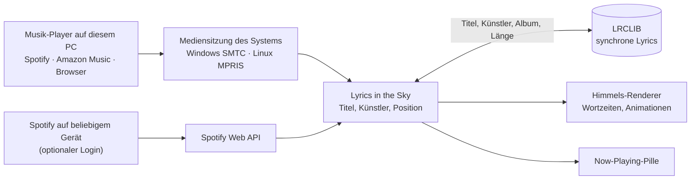

<div align="center">


# Lyrics in the Sky

**Der Song, den du gerade hörst, Wort für Wort am Minecraft-Himmel.**


[English version](README.md)


</div>

Lass auf deinem PC Musik laufen, egal ob Spotify, Amazon Music, YouTube Music oder ein anderer Player. Die
synchronisierten Songtexte erscheinen dann beim Spielen am Himmel: Jedes Wort ploppt im Takt in weicher
Handschrift auf, jede Zeile an einer anderen Stelle, und wenn sie vorbei ist, verweht sie wie eine Wolke.

## Funktionen

- **Wort für Wort synchron.** Genaue Wortzeiten, wenn die Lyrics sie haben; sonst verteilt die Mod die
  Wörter nach Länge über die Zeile.
- **Wirklich am Himmel.** Zeilen verhalten sich wie die Sonne: Sie wandern mit, stecken nie in Wänden,
  verschwinden hinter nahen Bäumen und Häusern und stehen vor den Wolken.
- **Viel Bewegung.** Sechs Einblendungen (aufploppen, hochschweben, Zoom, Wirbel, Fallen, Schreibmaschine),
  vier Ausblendungen (verschwimmen, aufsteigen, zerstreuen, zersplittern), Funken, weicher Glow bei Nacht
  und Schatten am Tag.
- **Jede Zeile woanders,** verteilt um deine Blickrichtung; lange Zeilen brechen versetzt auf zwei Reihen
  um, ein betontes Wort wird größer.
- **Zwei Anzeigemodi:** *am Himmel* (weit weg, nahe Blöcke verdecken die Zeilen) oder *um dich herum* (nah
  auf Augenhöhe, kreist langsam, immer sichtbar wie ein Hologramm).
- **Titelkarte** am Himmel, wenn ein neuer Song beginnt.
- **Now-Playing-Pille** oben mit aktueller Zeile, markiertem Wort und kleinem Equalizer.
- **Einstellungen mit der rechten Umschalttaste** und Live-Vorschau: sechs Farbpaletten, Handschrift oder
  Minecraft-Schrift, Größe, Höhe, Deckkraft, Timing und mehr.
- **Keine Anmeldung nötig** für Musik auf dem PC. **Optional Spotify-Login** für Musik vom Handy, von der
  Konsole oder einem anderen Spotify-Connect-Gerät.

<table>
<tr>
<td></td>
<td></td>
</tr>
<tr>
<td align="center">Einstellungen (rechte Umschalttaste)</td>
<td align="center">Modus „um dich herum“</td>
</tr>
</table>

## Voraussetzungen

| | |
|---|---|
| Minecraft | Java Edition 26.2 oder 26.3 |
| Mod-Loader | [Fabric Loader](https://fabricmc.net) 0.20.1+ und [Fabric API](https://modrinth.com/mod/fabric-api) |
| System | Windows 10/11 oder Linux mit `gdbus` (Teil von GLib, auf praktisch jedem Desktop installiert) |
| Java | 25 (bringt der Minecraft-Launcher mit) |

## Installation

1. `lyrics-in-the-sky-1.1.0+mc26.3.jar` (oder `…+mc26.2.jar`) und Fabric API in den `mods`-Ordner legen.
2. Spiel starten, Musik starten, Welt betreten.
3. Beim ersten Mal fragt die Mod im Chat, ob sie lrclib.net nach Songtexten fragen darf. **[Erlauben]**
   klicken.
4. **Rechte Umschalttaste** öffnet die Einstellungen. Ohne Musik ausprobieren: dort *Demo abspielen* oder
   `/skylyrics demo`.

## Optional: Spotify verbinden

Musik auf diesem PC – Spotify, Amazon Music, Browser – läuft ohne Anmeldung. Wenn du auf dem Handy, der
Konsole oder einem anderen Gerät hörst, verbinde stattdessen dein Spotify-Konto.

Die Builds dieses Repos bringen die Client-ID der App „Lyrics in the Sky“ schon mit (`spotify_client_id` in
`gradle.properties`). Für den Besitzer der App und die bis zu fünf dort eingetragenen Personen reicht deshalb
ein Klick auf **Mit Spotify verbinden** → im Browser **Zustimmen**. Alle anderen legen eine eigene App an:

1. Das [Spotify-Entwickler-Dashboard](https://developer.spotify.com/dashboard) öffnen (der Knopf *Spotify-App
   anlegen …* in den Einstellungen tut das) und eine App anlegen. Name egal. Als Redirect-URI
   `http://127.0.0.1:43217/callback` eintragen und *Web API* ankreuzen.
2. Die **Client ID** der App in das Feld *Client-ID deiner Spotify-App* kopieren.
3. **Mit Spotify verbinden** klicken. Im Browser öffnet sich Spotifys Zustimmungsseite: falls nötig anmelden
   und **Zustimmen** klicken. Danach schreibt die Seite „verbunden“ in einen Minecraft-Abendhimmel, und der Tab kann zu.

Eine Spotify-App im Entwicklungsmodus darf nur ihr Besitzer plus bis zu fünf Personen nutzen, die du unter
*User Management* einträgst, und der Besitzer braucht Spotify Premium. Amazon Music bietet keine vergleichbare
Anmeldung für fremde Apps; es läuft weiter automatisch über die Mediensitzung auf dem PC.

## Befehle

| Befehl | Wirkung |
|---|---|
| `/skylyrics settings` | Einstellungen öffnen (wie die rechte Umschalttaste) |
| `/skylyrics status` | Song, Player, Position, Lyrics-Status, Offset und Spotify-Login |
| `/skylyrics demo` | 37 Sekunden Demo mit eigenem Text |
| `/skylyrics on` · `off` | Lyrics ein- oder ausschalten |
| `/skylyrics mode <sky\|around>` | am Himmel oder um dich herum |
| `/skylyrics offset <ms>` | Verzögerung ausgleichen; positiv = Lyrics früher |
| `/skylyrics opacity <0.1–1>` | Deckkraft (Standard 0.82) |
| `/skylyrics scale <0.3–3>` | Textgröße |
| `/skylyrics height <10–70>` | Höhe über dem Horizont in Grad |
| `/skylyrics palette <name>` | `auto`, `aurora`, `sunset`, `gold`, `sakura`, `ocean`, `white` |
| `/skylyrics font <script\|minecraft>` | Handschrift oder Minecraft-Schrift |
| `/skylyrics follow <on\|off>` | neue Zeilen erscheinen dort, wo du hinschaust |
| `/skylyrics title <on\|off>` | Songtitel am Himmel beim Songwechsel |
| `/skylyrics hud <on\|off>` | Now-Playing-Pille oben |
| `/skylyrics lrclib <on\|off>` | Abfrage bei lrclib.net erlauben oder verbieten |
| `/skylyrics spotify <connect\|disconnect>` | optionales Spotify-Konto verbinden oder trennen |

**Tasten** (unter *Steuerung → Lyrics in the Sky*): Einstellungen (**rechte Umschalttaste**), dazu
standardmäßig unbelegt: Lyrics ein/aus, Lyrics 100 ms früher, Lyrics 100 ms später. Alle Einstellungen stehen
auch in `config/lyricsinthesky.json`.

## So funktioniert es



- **Was läuft gerade?** Unter Windows liest ein kleines PowerShell-Skript aus der Mod die
  Windows-Mediensitzung, unter Linux fragt die Mod MPRIS über `gdbus` ab. Zwischen den Meldungen des Players
  rechnet die Mod die Position selbst weiter, damit die Wörter im Takt bleiben.
- **Songtexte** kommen von [LRCLIB](https://lrclib.net), einer freien Datenbank für synchrone Lyrics.
  Gesendet werden nur Titel, Künstler, Album und Länge; gespeichert wird nichts.
- **Optionaler Spotify-Login** über Spotifys offizielle Web API mit Authorization Code + PKCE: kein
  Client-Secret, der Browser kehrt zu einer kleinen Seite zurück, die die Mod auf `127.0.0.1:43217` ausliefert,
  und die Tokens liegen in `config/lyricsinthesky/spotify.json` auf deinem PC.
- **Darstellung:** Der Text wird relativ zur Kamera gezeichnet, nach der Welt und vor der Hand, mit eigenen
  transparenten Text-Pipelines – im Himmelsmodus 48 Blöcke entfernt mit Tiefentest, im Modus „um dich herum“
  6 Blöcke entfernt ohne Tiefentest.

## Datenschutz und faire Nutzung

- Keine Anmeldung nötig. Der optionale Spotify-Login liest nur, was gerade läuft
  (`user-read-currently-playing`, `user-read-playback-state`), und lässt sich jederzeit trennen.
- Keine Cookies, keine inoffiziellen oder internen Schnittstellen.
- Abfragen erst nach deiner Erlaubnis; abschalten mit `/skylyrics lrclib off`.
- Lyrics werden beim Abspielen geholt und nur im Speicher gehalten. Das Projekt liefert oder hostet keine
  Songtexte.
- Nicht verbunden mit Mojang, Microsoft, Spotify, Amazon oder LRCLIB.

## Bekannte Grenzen

- macOS wird noch nicht unterstützt. Der Linux-Weg ist mit Beispieldaten getestet, aber noch nicht auf
  einem echten Desktop.
- Ohne Login meldet Spotify seine Position nur alle paar Sekunden; `/skylyrics offset` gleicht kleine
  Verzögerungen aus. Der Spotify-Client unter Linux meldet gar keine Position, nach dem Vorspulen ist die Zeit
  deshalb bis zum nächsten Song ungenau. Mit dem optionalen Spotify-Login ist die Position genau.
- Die eingebaute Spotify-App ist im Entwicklungsmodus: Außer ihrem Besitzer können sich nur fünf eingetragene
  Personen verbinden. Alle anderen brauchen ihre eigene Spotify-Entwickler-App (siehe oben).
- Livestreams und Videos ohne bekannte Länge bekommen keine Lyrics.
- Mit Shaderpacks (Iris) ungetestet.

## Selbst bauen

```bash
./gradlew collectJars             # Jars für beide Versionen in build/libs
./gradlew :mc26.3:runSelfTest     # Demo im Dev-Client abspielen, Screenshots speichern, beenden
./gradlew :mc26.3:runRecordPreview  # dasselbe in 1280×720, ein Bild pro Tick für ein Vorschauvideo
```

| Pfad | Inhalt |
|---|---|
| `src/` | gemeinsamer Code: Mediensitzungen, LRCLIB, Wortzeiten, Animationen, HUD, Befehle |
| `versions/26.2`, `versions/26.3` | Grafik-Anbindung pro Minecraft-Version (Mojang hat die Render-API in 26.3 umgebaut) |
| `reports/`, `research_notes/` | Recherche zu bestehenden Mods, APIs und Rechtsfragen |
| `preview/` | Vorschauvideo und Screenshots |

Regeln für Beiträge: [CONTRIBUTING.md](CONTRIBUTING.md). Versionen: [CHANGELOG.md](CHANGELOG.md).

## Lizenz

Code: [MIT](LICENSE). Schrift [Kalam](https://fonts.google.com/specimen/Kalam) © Indian Type Foundry,
[SIL Open Font License 1.1](src/main/resources/assets/lyricsinthesky/font/ofl.txt).
