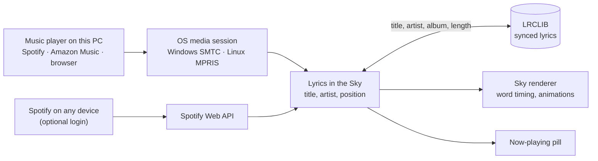

<div align="center">


# Lyrics in the Sky

**The song you are listening to, sung across the Minecraft sky – word by word.**


[Deutsche Version](README.de.md)


</div>

Play music on your PC – Spotify, Amazon Music, YouTube Music or any other player – and its synced lyrics
appear in the sky while you play. Each word pops in on the beat in soft handwriting, every line shows up in
a different spot, and when the line is over it dissolves like a cloud.

## Features

- **Synced word by word.** Exact word timing when the lyrics have it, otherwise the words are spread over
  the line by length.
- **Lives in the sky.** Lines are drawn like the sun: they follow you, never clip into walls, hide behind
  nearby trees and houses and stay in front of clouds.
- **Lots of motion.** Six entry animations (pop, rise, zoom, swirl, drop, typewriter), four exits
  (dissolve, float away, scatter, shatter), sparkles, a soft glow at night and a shadow by day.
- **Different spot for every line,** spread around where you are looking; long lines wrap into two
  staggered rows and one stressed word is drawn bigger.
- **Two display modes:** *in the sky* (far away, nearby blocks cover it) or *around you* (close at eye
  level, slowly circling, always visible like a hologram).
- **Title card** in the sky when a new song starts.
- **Now-playing pill** at the top of the screen with the current line, the sung word highlighted and a
  little equalizer.
- **Settings screen on Right Shift** with live preview: six color palettes, handwriting or Minecraft font,
  size, height, opacity, timing and more.
- **No login needed** for music on your PC. **Optional Spotify login** for music on your phone, console or
  any other Spotify Connect device.

<table>
<tr>
<td></td>
<td></td>
</tr>
<tr>
<td align="center">Settings on Right Shift</td>
<td align="center">"Around you" mode</td>
</tr>
</table>

## Requirements

| | |
|---|---|
| Minecraft | Java Edition 26.2 or 26.3 |
| Mod loader | [Fabric Loader](https://fabricmc.net) 0.20.1+ and [Fabric API](https://modrinth.com/mod/fabric-api) |
| System | Windows 10/11, or Linux with `gdbus` (part of GLib, installed on practically every desktop) |
| Java | 25 (ships with the Minecraft launcher) |

## Installation

1. Put `lyrics-in-the-sky-1.1.0+mc26.3.jar` (or `…+mc26.2.jar`) and Fabric API into your `mods` folder.
2. Start the game, start some music, join a world.
3. The first time, the mod asks in chat whether it may look up lyrics on lrclib.net. Click **[Erlauben]**.
4. Press **Right Shift** for the settings. Want to see it without music? Click *Demo abspielen* there or run
   `/skylyrics demo`.

## Optional: connect Spotify

Music playing on this PC – Spotify, Amazon Music, browsers – works without any login. If you listen on your
phone, a console or another device, connect your Spotify account instead:

1. Open the [Spotify developer dashboard](https://developer.spotify.com/dashboard) (the button *Spotify-App
   anlegen …* in the settings opens it) and create an app. Any name is fine. Add the redirect URI
   `http://127.0.0.1:43217/callback` and tick *Web API*.
2. Copy the app's **Client ID** into the settings field *Client-ID deiner Spotify-App*.
3. Click **Mit Spotify verbinden**. Your browser opens Spotify's consent page: log in if needed and click
   **Agree**. The browser then shows "Verbunden!" and you can close it.

Spotify only lets an app in development mode serve its owner plus up to five people you add under *User
Management*, and the owner needs Spotify Premium. Amazon Music has no comparable login for other apps; it keeps
working automatically through the media session on your PC.

## Commands

| Command | What it does |
|---|---|
| `/skylyrics settings` | Open the settings screen (same as Right Shift) |
| `/skylyrics status` | Song, player, position, lyrics status, offset and Spotify login |
| `/skylyrics demo` | 37-second demo with built-in text |
| `/skylyrics on` · `off` | Show or hide the lyrics |
| `/skylyrics mode <sky\|around>` | In the sky or around you |
| `/skylyrics offset <ms>` | Fix delay; positive shows lyrics earlier |
| `/skylyrics opacity <0.1–1>` | Transparency (default 0.82) |
| `/skylyrics scale <0.3–3>` | Text size |
| `/skylyrics height <10–70>` | Height above the horizon in degrees |
| `/skylyrics palette <name>` | `auto`, `aurora`, `sunset`, `gold`, `sakura`, `ocean`, `white` |
| `/skylyrics font <script\|minecraft>` | Handwriting or the Minecraft font |
| `/skylyrics follow <on\|off>` | New lines appear where you are looking |
| `/skylyrics title <on\|off>` | Song title in the sky when a song starts |
| `/skylyrics hud <on\|off>` | Now-playing pill at the top |
| `/skylyrics lrclib <on\|off>` | Allow or forbid lyrics lookups on lrclib.net |
| `/skylyrics spotify <connect\|disconnect>` | Connect or disconnect the optional Spotify account |

**Key bindings** (under *Controls → Lyrics in the Sky*): settings (**Right Shift**), and unbound by default:
toggle lyrics, lyrics 100 ms earlier, lyrics 100 ms later. Every setting is also stored in
`config/lyricsinthesky.json`.

## How it works



- **What is playing?** On Windows a small PowerShell script bundled in the mod reads the system media
  session; on Linux the mod asks MPRIS through `gdbus`. Between updates from the player the mod advances
  the position on its own, so words stay on the beat.
- **Lyrics** come from [LRCLIB](https://lrclib.net), a free database of synced lyrics. Only title, artist,
  album and length are sent; nothing is stored on disk.
- **Optional Spotify login** uses Spotify's official Web API with Authorization Code + PKCE: no client
  secret, the browser returns to a tiny page served by the mod on `127.0.0.1:43217`, and the tokens are kept in
  `config/lyricsinthesky/spotify.json` on your PC.
- **Drawing:** the text is rendered relative to the camera, after the world and before your hand, with its
  own transparent text pipelines – 48 blocks out with depth test in the sky mode, 6 blocks out without depth
  test in the around-you mode.

## Privacy and fair use

- No login needed. The optional Spotify login only reads what is playing (`user-read-currently-playing`,
  `user-read-playback-state`) and can be disconnected at any time.
- No cookies, no unofficial or internal APIs.
- Lookups only after you allow them; they can be switched off with `/skylyrics lrclib off`.
- Lyrics are fetched while playing and kept in memory only. This project does not ship or host any lyrics.
- Not affiliated with Mojang, Microsoft, Spotify, Amazon or LRCLIB.

## Known limitations

- macOS is not supported yet. The Linux path is tested with sample data, not yet on a real desktop.
- Without login, Spotify reports its position only every few seconds; `/skylyrics offset` fixes small delays.
  The Spotify client on Linux reports no position at all, so after seeking the timing is off until the next
  song. With the optional Spotify login the position is exact.
- The Spotify login needs your own Spotify developer app (see above); its development mode is limited to five
  extra users.
- Livestreams and videos without a known length get no lyrics.
- Shader packs (Iris) are untested.
- In-game messages and command feedback are in German for now.

## Building

```bash
./gradlew collectJars             # jars for both versions in build/libs
./gradlew :mc26.3:runSelfTest     # play the demo in a dev client, save screenshots, quit
./gradlew :mc26.3:runRecordPreview  # same at 1280×720, one screenshot per tick for a preview video
```

| Path | Contents |
|---|---|
| `src/` | Shared code: media sessions, LRCLIB, lyrics timing, animations, HUD, commands |
| `versions/26.2`, `versions/26.3` | Rendering glue per Minecraft version (Mojang reworked the render API in 26.3) |
| `reports/`, `research_notes/` | Research on existing mods, APIs and legal questions (German/English) |
| `preview/` | Preview video and screenshots |

See [CONTRIBUTING.md](CONTRIBUTING.md) for the ground rules and [CHANGELOG.md](CHANGELOG.md) for releases.

## License

Code: [MIT](LICENSE). Font [Kalam](https://fonts.google.com/specimen/Kalam) © Indian Type Foundry,
[SIL Open Font License 1.1](src/main/resources/assets/lyricsinthesky/font/ofl.txt).
