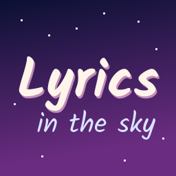
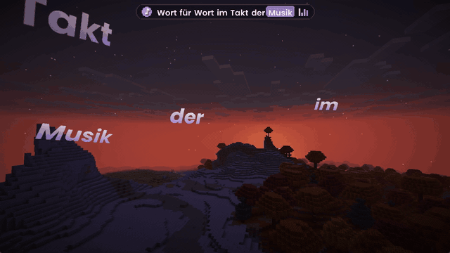
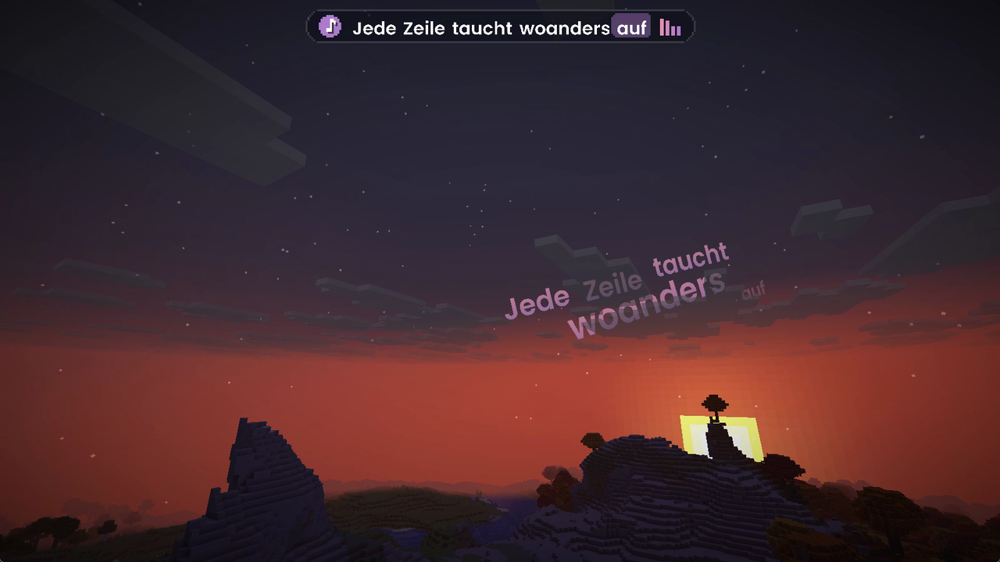
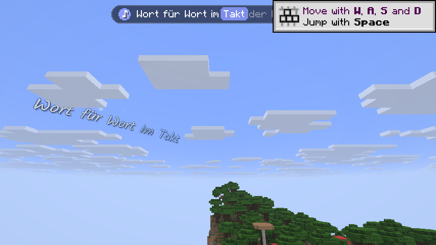
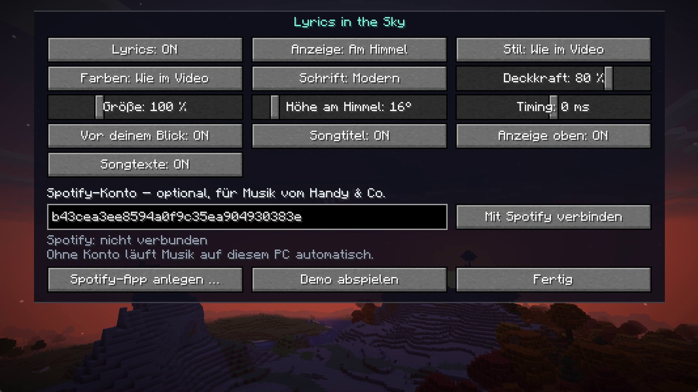
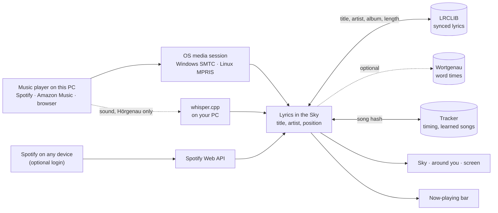

<div align="center">



# Lyrics in the Sky

**The song you are listening to, sung across the Minecraft sky – word by word.**


**[Download the newest build](https://github.com/Henner4746/lyrics-in-the-sky/releases/latest)** ·
[Sources](#sources-everything-the-mod-talks-to) · [Deutsche Version](README.de.md)



</div>

Play music on your PC – Spotify, Amazon Music, YouTube Music or any other player – and its synced lyrics
appear in the world while you play: built up word by word in the sky, as single words floating all around you,
or on the screen in eleven looks.

## Features

### Where the lyrics appear

- **In the sky:** word groups of different sizes build up each line close above the horizon, on staggered,
  gently rising rows turned slightly away from you, so the line reads with depth. Every group fades in as it
  is sung, the line fades out when the next one starts somewhere else. Like the sun, it stands behind
  everything: mountains, trees, houses and clouds are in front of it. One switch puts it in front of everything.
- **Around you:** every sung word floats on its own at a fixed spot near you – big, slanted, slightly
  turned – and stays there while you walk or fight, until it fades out a couple of seconds later. A "now
  playing" card hangs in front of you when a song starts.
- **On the screen**, in eleven looks: subtitles (*Untertitel*), karaoke filling up word by word, big lines on a stage
  (*Bühne*) like Spotify's and Apple Music's lyrics view, only the word being sung big (*Ein Wort*), typed letter by
  letter (*Schreibmaschine*), a news ticker (*Laufband*), a ball hopping from word to word (*Springender Ball*), words
  rolling like a wave (*Welle*), a column at the right edge (*Seitenleiste*), words popping up in their own size and
  slant (*Kinetisch*) or speech bubbles like in a messenger (*Chat*); at the bottom, in the middle or at the top.
- **16 painted skies** of the mod's own behind the lyrics – northern lights, a sea of stars, a nebula, a light show,
  fireworks, a thunderstorm, an equalizer around the horizon, a retro sun, afterglow, petal rain, a full moon, a
  ringed planet, a black hole, a vinyl moon, a pastel morning and a rainbow. They move with the music: lights flare up
  on every sung word, a new line sends up fireworks or a shooting star, strong words strike lightning. All painted by
  the mod itself from noise, no image files.

### Synced word by word

- **Exact word timing** when the lyrics have it, otherwise the words follow the pace the song is sung at. Skipping
  within a song shows up at once.
- **Wortgenau** (optional): six services that time every word, for many more songs word by word
  ([details](#wortgenau-optional-unofficial-services)).
- **Hörgenau** (optional, Windows and Linux): a speech AI on your PC times songs nobody has timed and checks the sync
  of word-timed songs ([details](#hörgenau-listening-for-songs-no-service-knows)).
- **Timing per song** with one slider or two keys; corrections that many players agreed on apply for everyone.

### Your look

- **22 presets** set the whole look with one click: Standard, Himmel 1:1, Um dich 1:1, Party, Ruhig, Glas,
  Untertitel, Karaoke, Bühne, Neon-Nacht, Regenbogen, Kino, Retro, Schlicht, Ein Wort, Schreibmaschine, Laufband,
  Karaoke-Ball, Welle, Seitenleiste, Kinetisch and Chat.
- **Four styles:** *Elegant*, *Natürlich 1:1* (as if it really stood in the world: lines right above the hills,
  players and blocks in front of the words around you), *Stapel* (the current line in the middle, the next one faintly
  below, gliding up) and *Verspielt* (pop, zoom, swirl and more, with sparkles).
- **Colors:** gradient text in 12 palettes (rose, lavender, *Glas*, *Neon*, *Regenbogen* with a new hue for every
  line, …), a different one per song, or your **own four colors** (top, bottom, the sung word, the glow) from a color
  picker; glow at night, shadow by day and an optional **outline** in any color and width.
- **Now-playing bar** with the current line and the sung word highlighted, as a pill, karaoke box, plain words or
  only the title; drag it anywhere, with your size, roundness, accent color, progress line, artist and equalizer.
- **Liquid Glass** (default): the bar and the settings as frosted glass, the world behind the settings softly
  blurred. *Klassisch* keeps the black-and-white look.
- **Make it yours:** capitals, animation speed, wobble on the beat, lyrics that turn along with your view, what
  happens on pause (dim, fade out, keep), lyrics further left or right, the bar's own font and how the sung word is
  marked.

### Menu and language

- **The menu on Right Shift** in three looks with the same pages and options: *Minimal* (default, the quiet look it
  always had), *Glas* (a black glass window with a card for every part of the mod) and *Prachtvoll* (glass with an
  aurora, rising notes and light on the rim). Every page has a **live preview**, options that do not apply right now
  are hidden, and the start page leads with five presets.
- **German or English:** the first time the menu opens it asks which language the mod speaks; *auto* follows the
  game.

### And

- **No login needed** for music on your PC; an **optional Spotify login** for music on your phone, console or any
  other Spotify Connect device.
- **Streamer mode** hides explicit words in lyrics, titles and artists.
- **Lyrics kept on your PC**, so a song heard before still has them when a service is offline.

<table>
<tr>
<td></td>
<td></td>
<td></td>
</tr>
<tr>
<td align="center">In the sky</td>
<td align="center">Around you</td>
<td align="center">Settings on Right Shift</td>
</tr>
</table>

Full preview video: [preview/lyrics-in-the-sky-preview.mp4](preview/lyrics-in-the-sky-preview.mp4)

## Requirements

| | |
|---|---|
| Minecraft | Java Edition 26.2 or 26.3 |
| Mod loader | [Fabric Loader](https://fabricmc.net) 0.18.4+ (26.2) or 0.19.3+ (26.3) and [Fabric API](https://modrinth.com/mod/fabric-api) |
| System | Windows 10/11, or Linux with `gdbus` (part of GLib, installed on practically every desktop); on macOS only with the Spotify login |
| Java | 25 (ships with the Minecraft launcher) |

## Installation

1. Download the newest build from [GitHub Releases](https://github.com/Henner4746/lyrics-in-the-sky/releases/latest):
   the jar ending in `+mc26.3.jar` for Minecraft 26.3 or `+mc26.2.jar` for 26.2. Put it into your `mods` folder
   together with Fabric API. The mod is also submitted to
   [CurseForge](https://www.curseforge.com/minecraft/mc-mods/lyrics-in-the-sky) and Modrinth; both are still
   reviewing it.
2. Start the game, start some music, join a world.
3. Lyrics come from lrclib.net, which is on from the start; the first time, a note in chat says what is sent
   and offers to switch it off.
4. Press **Right Shift** for the settings. Want to see it without music? Click *Demo abspielen* there or run
   `/skylyrics demo`.

## Which system, which player

| | Windows | Linux | macOS |
|---|---|---|---|
| Music playing on this PC (Spotify, Amazon Music, YouTube Music in the browser, …) | yes, through the Windows media session | yes, through MPRIS | not yet |
| Spotify on any device, with the optional login | yes | yes | yes (untested) |
| Hörgenau | yes, one click sets it up | yes, with whisper.cpp built yourself | no |

The mod brings no library of its own for this: on Windows a small PowerShell script inside the mod reads the
system's media session, the same one the volume flyout shows; on Linux the mod asks MPRIS with `gdbus`. Between
updates from the player the mod advances the position on its own, so words stay on the beat.

## Optional: connect Spotify

Music playing on this PC – Spotify, Amazon Music, browsers – works without any login. If you listen on your
phone, a console or another device, or on a Mac, connect your Spotify account instead.

Builds from this repository ship with the client ID of the "Lyrics in the Sky" app (`spotify_client_id` in
`gradle.properties`). Its owner and the up to five people added to it only need to click **Mit Spotify
verbinden** and then **Agree** in the browser. Everyone else creates their own app:

1. Open the [Spotify developer dashboard](https://developer.spotify.com/dashboard) (the button *Spotify-App
   anlegen …* in the settings opens it) and create an app. Any name is fine. Add the redirect URI
   `http://127.0.0.1:43217/callback` and tick *Web API*.
2. Copy the app's **Client ID** into the settings field *Client-ID deiner Spotify-App*.
3. Click **Mit Spotify verbinden**. Your browser opens Spotify's consent page: log in if needed and click
   **Agree**. The page then writes "verbunden" into a Minecraft dusk sky and you can close the tab.

Spotify only lets an app in development mode serve its owner plus up to five people you add under *User
Management*, and the owner needs Spotify Premium. Amazon Music has no comparable login for other apps; it keeps
working automatically through the media session on your PC.

## Sources: everything the mod talks to

The mod ships no lyrics and no libraries besides Fabric API. Everything it shows comes from the places below, and
nothing else is contacted: no analytics, no ads, no update check.

### On your PC (nothing leaves it)

| Source | What for |
|---|---|
| Windows media session (SMTC), read by a PowerShell script bundled in the mod | title, artist, album, length and position of what plays on Windows |
| MPRIS over D-Bus, asked with `gdbus` | the same on Linux |
| The sound of your music app: Windows process loopback, on Linux the app's PulseAudio stream (`parec`) | only for Hörgenau, while it is on; kept in memory, briefly a file for whisper.cpp that is deleted right after |
| `config/lyricsinthesky/lyrics` | lyrics and word times found before, up to 1000 songs |

### Online

| Service | Address | What for | When | What it gets |
|---|---|---|---|---|
| [LRCLIB](https://lrclib.net) | `lrclib.net` | synced lyrics (lines) | on from the start; `/skylyrics lrclib off` | title, artist, album, length |
| Deezer | `api.deezer.com`, `auth.deezer.com`, `pipe.deezer.com` | word times (Deezer's lyrics are Musixmatch's) | Wortgenau, off until you switch it on | artist and title, then Deezer's song ID; an anonymous session that lives only in memory |
| LyricsPlus | `lyricsplus.prjktla.my.id` | word times from Apple Music and QQ Music; stands in with lines when LRCLIB has none | Wortgenau | title, artist, album, length |
| NetEase Cloud Music | `music.163.com` | word times ("YRC") | Wortgenau | artist and title |
| Kugou Music | `lyrics.kugou.com` | word times ("KRC") | Wortgenau | artist, title, length |
| SyncLRC | `api.synclrc.dev` | word times, for songs someone timed before | Wortgenau | title, artist, album, length |
| [Better Lyrics](https://better-lyrics.boidu.dev/) | `api.betterlyrics.org` | word times, mostly Apple Music's | Wortgenau | title, artist, album, length |
| Timing tracker ([source](tracker/)) | `henrik.click/lyrics-sync/v1/corrections` | timing corrections players agreed on | asked for every song with lyrics; sending is on from the start, `/skylyrics share off` | the song as a hash; when sending, your correction and a random ID of your installation |
| Shared learning (same tracker) | `henrik.click/lyrics-sync/v1/learned` | songs other players' Hörgenau timed | asked before a song without word times is estimated; sending only with Hörgenau on, `/skylyrics sharelearned off` | the song as a hash; when sending, the song (artist, title, album, length), the word times with a fingerprint of the text, the text itself only for songs nobody has the text of, and the installation ID |
| Music catalogs | `api.deezer.com/search`, `itunes.apple.com/search` | whether something is a song (no livestream, video or podcast) | only with Hörgenau on, for songs nobody has the text of | artist and title |
| [whisper.cpp](https://github.com/ggml-org/whisper.cpp) | `github.com` (release b5454) | the speech AI program for Hörgenau, Windows build | once, when you switch Hörgenau on | nothing; the download is checked against a fixed checksum |
| Whisper model | `huggingface.co/ggerganov/whisper.cpp` | the model *Schnell* (small) or *Genau* (large-v3-turbo, 574 MB) | once, when you switch Hörgenau on or change the model | nothing; checked against a fixed checksum |
| Spotify Web API | `accounts.spotify.com`, `api.spotify.com` | what plays on your account, on any device | only after you connect Spotify | the login (Authorization Code + PKCE, no client secret) and the question what is playing; scopes `user-read-currently-playing`, `user-read-playback-state` |

The unofficial services are asked at most once a second each, with the mod's name as user agent, and without
cookies or keys. A service that fails is left alone for five minutes.

### Thanks

- [LRCLIB](https://lrclib.net) and everyone who times lyrics there.
- The services behind Wortgenau: Deezer and Musixmatch, the YouLy+ project's LyricsPlus server (Apple Music, QQ
  Music), NetEase Cloud Music, Kugou Music, SyncLRC and [Better Lyrics](https://better-lyrics.boidu.dev/). None of
  them are affiliated with this mod; it uses what they offer openly, and only when you switch it on.
- [whisper.cpp](https://github.com/ggml-org/whisper.cpp) by Georgi Gerganov and contributors (MIT) and OpenAI's
  [Whisper](https://github.com/openai/whisper) models (MIT), which Hörgenau runs on your PC.
- The [JamendoLyrics](https://github.com/f90/jamendolyrics) benchmark, used to measure how exact Hörgenau is; nothing
  of it ships with the mod.
- [Fabric](https://fabricmc.net) and [Fabric API](https://modrinth.com/mod/fabric-api).
- The fonts [Poppins](https://fonts.google.com/specimen/Poppins) and [Kalam](https://fonts.google.com/specimen/Kalam)
  (see [License](#license)).

## Commands

| Command | What it does |
|---|---|
| `/skylyrics settings` | Open the settings screen (same as Right Shift) |
| `/skylyrics status` | Song, player, position, lyrics status, offset and Spotify login |
| `/skylyrics demo` | 37-second demo with built-in text |
| `/skylyrics on` · `off` | Show or hide the lyrics |
| `/skylyrics mode <sky\|around\|screen>` | In the sky, around you or on the screen |
| `/skylyrics style <elegant\|natural\|flow\|classic>` | Look: elegant, natural, gliding stack, or playful |
| `/skylyrics preset <name>` | A whole look at once: `standard`, `sky`, `around`, `party`, `calm`, `glass`, `subtitle`, `karaoke`, `stage`, `neon`, `rainbow`, `cinema`, `retro`, `clean`, `word`, `typewriter`, `ticker`, `bounce`, `wave`, `sidebar`, `kinetic`, `chat` |
| `/skylyrics sky <name\|off>` | A painted sky: `northern`, `stars`, `nebula`, `lightshow`, `fireworks`, `storm`, `equalizer`, `retro`, `afterglow`, `petals`, `fullmoon`, `ringworld`, `blackhole`, `vinyl`, `pastel`, `rainbow` |
| `/skylyrics palette <name>` | `standard`, `rose`, `lavender`, `auto` (per song), `aurora`, `sunset`, `gold`, `sakura`, `ocean`, `white`, `glass`, `neon`, `rainbow`, `custom` |
| `/skylyrics font <sans\|script\|minecraft>` | Modern, handwriting or the Minecraft font |
| `/skylyrics offset <ms>` | Fix delay for all songs; positive shows lyrics earlier |
| `/skylyrics songoffset <ms\|reset>` | Fix the timing of the song playing now only; `reset` goes back to the shared correction |
| `/skylyrics opacity <0.1–1>` | Transparency (default 0.82) |
| `/skylyrics scale <0.3–3>` | Text size |
| `/skylyrics height <10–70>` | Height above the horizon in degrees |
| `/skylyrics glow <0–2>` | Glow at night and shadow by day around the lyrics; above 1 with a dark outline |
| `/skylyrics follow <on\|off>` | New lines appear where you are looking |
| `/skylyrics along <on\|off>` | Lyrics turn along with your view |
| `/skylyrics behind <on\|off>` | In the sky behind mountains and clouds, or in front of everything |
| `/skylyrics beat <on\|off>` | Wobble on every sung word |
| `/skylyrics title <on\|off>` | Song title in the sky when a song starts |
| `/skylyrics hud <on\|off>` | Now-playing bar on or off |
| `/skylyrics bar <pill\|karaoke\|plain\|title>` | Look of the bar |
| `/skylyrics barpos <top\|bottom>` | Bar at the top or above the hotbar (move it freely with the "Leiste" button in the settings) |
| `/skylyrics barsize <0.75–1.5>` · `barbg <0–1>` · `barround <0–1>` | Size of the bar, how solid its background is, its corners |
| `/skylyrics theme <classic\|glass>` | Bar and settings in black and white, or Liquid Glass (default) |
| `/skylyrics menu <minimal\|glass\|fancy>` | Look of the menu |
| `/skylyrics language <auto\|de\|en>` | The mod in German or English; `auto` as the game |
| `/skylyrics streamer <on\|off>` | Hide explicit words |
| `/skylyrics lrclib <on\|off>` | Allow or forbid lyrics lookups on lrclib.net |
| `/skylyrics wortgenau <on\|off>` | All word time services at once (also `grauzone`; off by default) |
| `/skylyrics source <deezer\|lyricsplus\|netease\|kugou\|synclrc\|betterlyrics> <on\|off>` | One word time service at a time |
| `/skylyrics hoergenau <on\|off>` | Hörgenau, the speech AI on your PC |
| `/skylyrics share <on\|off>` | Share timing corrections anonymously |
| `/skylyrics sharelearned <on\|off>` | Share what Hörgenau learned |
| `/skylyrics spotify <connect\|disconnect>` | Connect or disconnect the optional Spotify account |

**Key bindings** (under *Controls → Lyrics in the Sky*): settings (**Right Shift**), and unbound by default:
toggle lyrics, lyrics 100 ms earlier, lyrics 100 ms later. While a song with lyrics plays, the two timing keys
correct that song only. Every setting is also stored in `config/lyricsinthesky.json`, corrections per song in
`config/lyricsinthesky/song-timing.json`.

## How it works



- **Lyrics** come from [LRCLIB](https://lrclib.net), a free database of synced lyrics. Lyrics that were found are
  kept in `config/lyricsinthesky/lyrics` (up to 1000 songs), so a song heard before still has them when LRCLIB is
  busy or offline. When the exact lookup finds nothing, the mod tries the title without version notes ("- Remastered
  2009", "(Single Mix)"), then a free search. If LRCLIB only has the text without times, it is spread over the song
  (marked "≈").
- **Timing per song:** a song whose lyrics run early or late can be corrected on its own. These corrections are
  shared anonymously with a small tracker at `henrik.click/lyrics-sync` (source in [`tracker/`](tracker/)). What a
  player's Hörgenau measured applies to everyone at once, unless other measurements contradict it; corrections set
  by hand apply once 10 players corrected a song and most of them agree. The mod asks for every song with lyrics,
  also with sharing switched off.
- **Optional Spotify login** uses Spotify's official Web API with Authorization Code + PKCE: no client
  secret, the browser returns to a tiny page served by the mod on `127.0.0.1:43217`, and the tokens are kept in
  `config/lyricsinthesky/spotify.json` on your PC.
- **Drawing:** own transparent text pipelines with a color gradient per letter. The sky text is drawn right
  after the sky, camera-relative like the sun, so everything drawn later stands in front of it; the words
  around you are anchored in the world 5 to 9 blocks away and drawn last, on top of everything. The painted skies
  are made in a background thread and drawn on a dome in the sky pass, before the lyrics.

## Wortgenau: optional unofficial services

LRCLIB mostly times whole lines; the words in between are estimated. "Wortgenau" asks services that time every
word. **All of them are unofficial ("Grauzone"):** they are free to reach without any account, cookie or key, but
they are not meant for other apps, can change or disappear any day, and are each off until you switch them on –
all at once with "Wortgenau" (or "Grauzone" on the page *Quellen*), or one by one there and with
`/skylyrics source <name> on|off`. All switched on are asked at once; their answers are weighed in the order that
fitted most songs in tests:

| Service | Where its word times come from | What it gets |
|---|---|---|
| **Deezer** | Deezer's lyrics (Musixmatch, the same timing as Spotify's), through Deezer's web player with an anonymous session that lives only in memory | artist and title (to `api.deezer.com`), then the Deezer song ID (to `pipe.deezer.com`) |
| **LyricsPlus** | the server of the YouLy+ extension, which reads Apple Music and QQ Music | title, artist, album, length (to `lyricsplus.prjktla.my.id`) |
| **NetEase** | NetEase Cloud Music's "YRC" lyrics, also for many western songs | artist and title (to `music.163.com`) |
| **Kugou** | Kugou Music's "KRC" lyrics, often the same as QQ Music's | artist, title, length (to `lyrics.kugou.com`) |
| **SyncLRC** | a free lyrics API with karaoke times per word, only for songs someone timed before | title, artist, album, length (to `api.synclrc.dev`) |
| **Better Lyrics** | the server of the [Better Lyrics](https://better-lyrics.boidu.dev/) extension, mostly Apple Music's word times; without a key only for songs it has kept | title, artist, album, length (to `api.betterlyrics.org`) |

Word times are only shown when they belong to the recording you hear: each LRCLIB line's first words have to be
sung when the line starts, give or take one steady shift (a longer intro of another mastering), or two services
that timed the song independently have to agree with each other (hand-made LRCLIB lines sometimes drift by a
second). Where LRCLIB's lines only scatter a little around the service's, in the same order, the service's times
are taken unless another service fits closely. Otherwise the words are estimated as before. Results, and "nothing
found" for two weeks, are kept in `config/lyricsinthesky/lyrics`; a service that fails is left alone for five
minutes, so nothing hangs. Without LRCLIB lyrics, the first service that has the song with word times stands in,
else LyricsPlus line by line.

## Hörgenau: listening for songs no service knows

*Windows and Linux, off until you switch it on.* Some songs nobody has timed, some have no lyrics anywhere. For
those **Hörgenau** listens: when such a song plays, the mod records the sound of your music app wherever it has not
heard it yet (in memory only). If you hear only part of it, it keeps the heard words with their times in the song and
hears the rest the next time. Every part is heard by [whisper.cpp](https://github.com/ggml-org/whisper.cpp); once
about four fifths of the song were heard, it is timed. If LRCLIB has the text without times, that text is placed on
what was heard; if there is none, what was heard becomes the lyrics. From the next play on the song runs word by
word. If LRCLIB gets real lines later, they replace what was learned.

- **Cost:** a one-time download of about 190 MB (whisper.cpp from GitHub, the "small" model from Hugging Face, both
  checked against a fixed checksum), or 574 MB for the model *Genau* (Whisper large-v3-turbo). Per learned song, once,
  about 1–2 minutes of up to four CPU cores at low priority (*Genau* about four times as long) and up to 750 MB of
  memory in a separate process; *Leistung* chooses two cores, a quarter of them or all but one. The listening itself
  costs next to nothing.
- **Models:** *Schnell* (small) and *Genau* (large-v3-turbo), calibrated on the songs below: *Genau* heard 87, 94 and
  86 % of the sung words where *Schnell* heard 77, 92 and 80 %, with the same timing.
- **Sync check** (*Sync prüfen*, on with Hörgenau): a song that has word times is heard once for 50 s, its heard
  words are compared with the shown ones, and when nearly all agree that the lyrics run early or late by the same
  amount, the song is moved by it – a source timed for another version of the song. Measured live against the sung
  audio, two of twelve songs came 0.8 and 1.1 s late this way while the others were within a tenth of a second. The
  correction is the song's own timing ("Dieser Song"), never replaces one you set, and goes to the tracker as
  measured, also when the lyrics fit, where it counts for every player at once.
- **Accuracy:** measured on three real German songs with hand-made timings from the
  [JamendoLyrics](https://github.com/f90/jamendolyrics) benchmark (rock, pop, rap): line starts were 43–89 ms off in
  the median, 71–88 % of them less than 200 ms and 91–100 % less than a second. Played through the speakers while the
  game ran, the pop song was learned in 55 s with line starts 60 ms off in the median. Stretches Whisper misses on the
  whole song are heard once more on their own; words it still does not understand are placed between their neighbours.
- **Only the player is heard:** Hörgenau records only the sound of the app playing the song (Spotify, say), through
  Windows' process loopback (Windows 10 2004 and newer). Voice chat, videos in other apps and the game's own sounds
  stay out. Measured on Windows 11: a test tone from another program was 8354 loud in the recording of everything and
  12 in Spotify's; a voice talking over the song was written down by Whisper only from the recording of everything.
  When Windows cannot find the player, or its sound stays silent while the PC plays something, Hörgenau records
  everything as before. Then: while another player sounds too (a video in the browser), it does not listen or throws
  the recording away, and voice chat it cannot tell apart.
- **On Linux** Hörgenau records the music app's own PulseAudio stream (PipeWire's PulseAudio server works too) with
  `parec` from `pulseaudio-utils`, found by its MPRIS name; without it, all the default output plays. whisper.cpp
  ships no build for Linux: build it yourself and put `whisper-cli` with its libraries into
  `config/lyricsinthesky/hoergenau/bin`; the model is downloaded and checked as on Windows.
- **Quiet recordings, made-up lines:** the player's own sound comes without what Windows raises afterwards and was up
  to 17 dB quieter; Hörgenau makes it louder before Whisper hears it. Lines Whisper makes up from subtitles
  ("Untertitel im Auftrag des ZDF") are dropped.
- **What it learns counts for everyone:** when Hörgenau placed a song on lrclib.net's text, only the times of the
  words and a fingerprint of that text go to the tracker on henrik.click, not the lyrics; other players put the times
  on their own text from lrclib.net, and only when it is exactly the same, which the tracker checks on lrclib.net
  first. For a song nobody has the text of, what Hörgenau wrote down is shared with its text, so others get the song
  word by word at once; it counts once players on two networks heard it alike, and only while lrclib.net has no text
  for it. On by default; "Gelerntes teilen" on the page *Hörgenau (KI)* or `/skylyrics sharelearned off` switches
  the sending off; what others learned is fetched either way.
- **Only songs:** a song nobody has the text of is heard only with a song's length (30 s to 20 min) and when Deezer's
  or Apple's catalog know a song of that artist with that title; a livestream, a video or a podcast is never written
  down. The tracker checks the same before it takes such lyrics.
- **From the start:** a new song is listened to from its start while it is still looked up, so its first seconds
  are not missed; that recording stays in memory and is dropped as soon as the lookup shows the song needs nothing
  (at most a minute, never for a livestream).
- **The title's spelling:** words heard almost like a word of the song's title or artist take that spelling; other
  forms of the word stay as heard.
- **Privacy:** it hears the sound of your music app, where that cannot be told apart everything that plays on the
  default speakers, voice chat included, while such a song plays (and for the 50 s of a sync check, and the first
  seconds of a new song while it is looked up). The recording never leaves the PC and does not stay on disk, except
  briefly as a file for whisper.cpp that is deleted right after. With "Gelerntes teilen" on, the word times go to the
  tracker, and the text only of songs nobody has the text of.
- Switch it on on the page *Hörgenau (KI)* of the menu, which also explains step by step what the AI does, with
  `/skylyrics hoergenau on`, or with the button the mod offers in chat when a song has no word times. A note in the
  corner tells what it is doing; while it records the playing song, the bar's icon is a red recording light.

## Privacy and fair use

- No login needed. The optional Spotify login only reads what is playing (`user-read-currently-playing`,
  `user-read-playback-state`) and can be disconnected at any time.
- No cookies, no analytics, no ads. The unofficial word time services are only asked when you switch them on, at
  most once a second each, with the mod's name as user agent.
- Lookups on lrclib.net are on from the start, with a note in chat the first time; switch them off in the settings
  or with `/skylyrics lrclib off`.
- Sharing timing corrections is on from the start, with a note in chat the first time; switch it off with
  "Teilen" in the settings or `/skylyrics share off`, then nothing of yours is sent to the tracker; the mod still
  asks it about songs, with their hashes. The tracker keeps per correction only the song hash, the milliseconds
  (for one Hörgenau measured, also how many words it paired and how close), keyed hashes of your installation ID
  and network, no IP addresses and no access log.
- Lyrics are fetched while playing; the ones found stay on your PC in `config/lyricsinthesky/lyrics`, which
  you can delete at any time. The mod ships no lyrics. Of songs players' Hörgenau learned, the tracker keeps the
  word times (song key, names, length, word times, fingerprint of the text, keyed hashes of installation ID and
  network), and the lyrics written down only of songs nobody has the text of; with "Gelerntes teilen" off nothing is
  shared.
- Not affiliated with Mojang, Microsoft, Spotify, Amazon, LRCLIB or any of the services listed under
  [Sources](#sources-everything-the-mod-talks-to).

## Known limitations

- **macOS:** no media session support yet, so only music on a connected Spotify account is seen; this way is
  untested, as is the mod on macOS in general. Hörgenau does not run there.
- **Linux:** tested in a real game with the official Spotify client on a Linux machine (no regular desktop session).
  The Spotify client on Linux reports no position at all, so after seeking the timing is off until the next song;
  with the optional Spotify login the position is exact.
- Without login, Spotify reports its position only every few seconds; `/skylyrics offset` fixes small delays.
- The built-in Spotify app is in development mode: besides its owner only five added people can connect.
  Everyone else needs their own Spotify developer app (see above).
- Livestreams and videos without a known length get no lyrics.
- With a shader pack (Iris) the text is drawn on top of the pack's finished image: hills, trees and walls
  still hide it, the pack's own clouds do not. The painted skies give way to the pack's own sky. Tested with
  Complementary Reimagined.

## Building

```bash
./gradlew collectJars             # jars for both versions in build/libs
./gradlew :mc26.3:runSelfTest     # play the demo in a dev client, save screenshots, quit
./gradlew :mc26.3:runRecordPreview  # same at 1280×720, one screenshot per tick for a preview video
```

| Path | Contents |
|---|---|
| `src/` | Shared code: media sessions, lyrics and word time services, Hörgenau, timing, animations, skies, menu, commands |
| `versions/26.2`, `versions/26.3` | Rendering glue per Minecraft version (Mojang reworked the render API in 26.3) |
| `tracker/` | The timing tracker on henrik.click |
| `preview/` | Preview video and screenshots |

See [CONTRIBUTING.md](CONTRIBUTING.md) for the ground rules and [CHANGELOG.md](CHANGELOG.md) for releases.

## License

Code: [MIT](LICENSE). Fonts under the SIL Open Font License 1.1:
[Poppins](https://fonts.google.com/specimen/Poppins) © The Poppins Project Authors
([license](src/main/resources/assets/lyricsinthesky/font/poppins-ofl.txt)) and
[Kalam](https://fonts.google.com/specimen/Kalam) © Indian Type Foundry
([license](src/main/resources/assets/lyricsinthesky/font/ofl.txt)).
