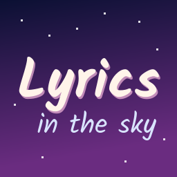
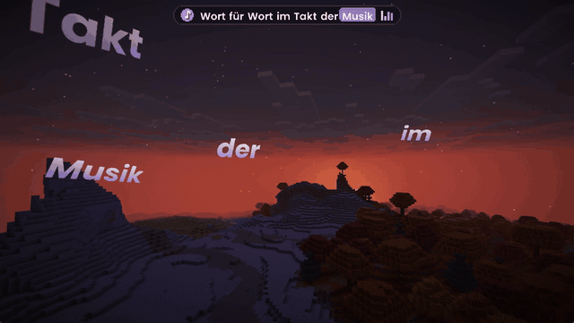
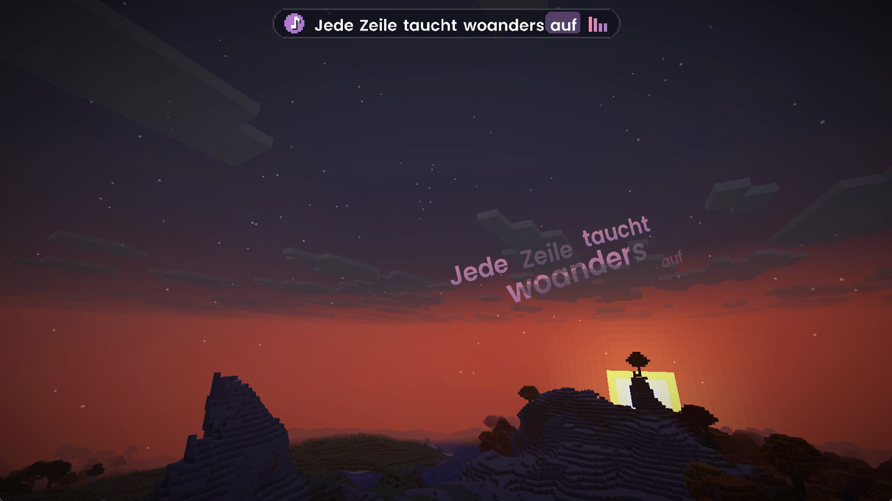
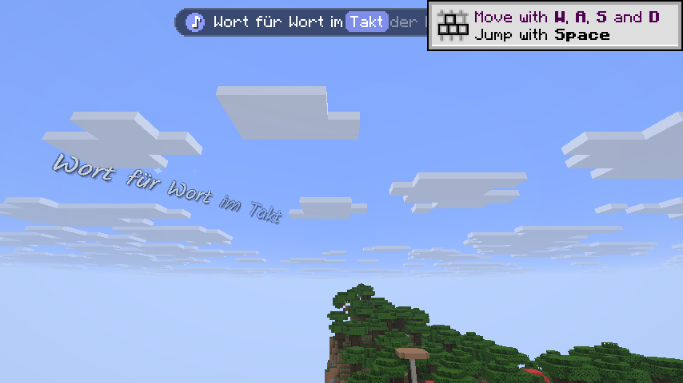
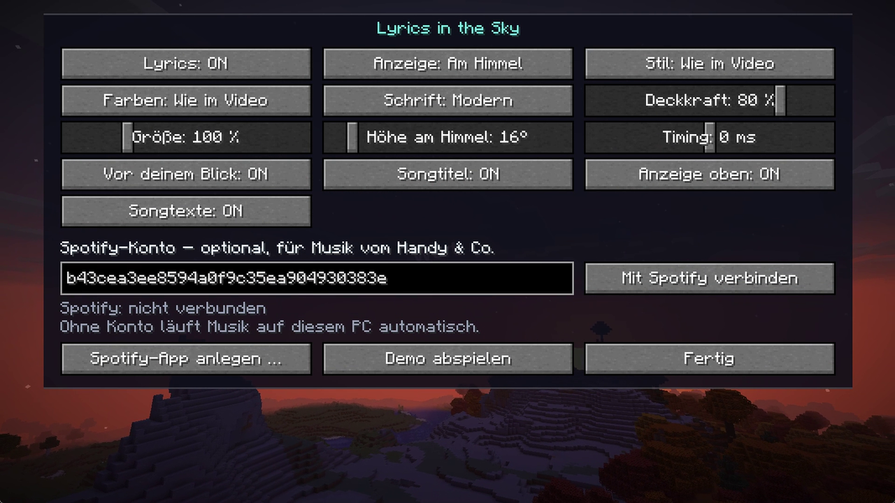
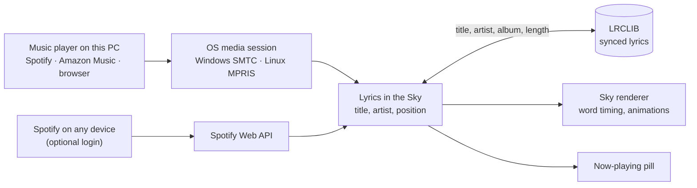

<div align="center">



# Lyrics in the Sky

**The song you are listening to, sung across the Minecraft sky – word by word.**


**[Download on CurseForge](https://www.curseforge.com/minecraft/mc-mods/lyrics-in-the-sky)** · [Deutsche Version](README.de.md)



</div>

Play music on your PC – Spotify, Amazon Music, YouTube Music or any other player – and its synced lyrics
appear in the world while you play: built up word by word in the sky, or as single words floating all around
you.

## Features

- **Synced word by word.** Exact word timing when the lyrics have it, otherwise the words follow the pace
  the song is sung at. Skipping within a song shows up at once. With **Wortgenau** switched on, most songs get
  real word times from several services (see [Wortgenau](#wortgenau-optional-unofficial-services)).
- **In the sky:** word groups of different sizes build up each line close above the horizon, on staggered,
  gently rising rows turned slightly away from you, so the line reads with depth. Every group fades in as it
  is sung, the line fades out when the next one starts somewhere else. Like the sun, it stands behind
  everything: mountains, trees, houses and clouds are in front of it.
- **Around you:** every sung word floats on its own at a fixed spot near you – big, slanted, slightly
  turned – and stays there while you walk or fight, until it fades out a couple of seconds later. A "now
  playing" card hangs in front of you when a song starts.
- **Colors of your choice:** gradient text in rose, lavender or eight more palettes (new: *Glas* and *Neon*), or a
  different one per song; glow at night and shadow by day as strong as you like.
- **Four styles:** *Elegant* (the two looks above), *Natürlich 1:1* (the same as if it really stood in the world:
  lines right above the hills, players and blocks in front of the words around you, the words being sung
  highlighted as a group), *Stapel* (the current line in the middle, the next
  one faintly below, gliding up from line to line) and *Verspielt* (pop, zoom, swirl and more, with sparkles).
- **Now-playing bar** with the current line and the sung word highlighted, as a pill, karaoke box, plain words or
  only the title; movable, in your size, roundness and density.
- **Liquid Glass** (default): the bar and the settings as frosted glass like iOS 26, with a bright rim and a soft
  shadow; the world behind the settings is softly blurred. *Klassisch* keeps the black-and-white look.
- **Presets:** Standard, Himmel 1:1, Um dich 1:1, Party, Ruhig and Glas set the whole look with one click.
- **Turn along** (optional): the lyrics follow your view closely instead of staying where they appeared.
- **Wobble on the beat** (optional): every sung word gives the lyrics a little kick, long words a stronger one.
- **Behind the hills or always visible:** in the sky the text stands behind mountains, trees and clouds like
  the sun; one switch puts it in front of everything instead.
- **Settings screen on Right Shift** with live preview, in three pages: *Allgemein* (mode, style, timing, lookups,
  Spotify), *Aussehen* (theme, font, colors, sizes, glow, the bar) and *Quellen* (where lyrics and word times come
  from).
- **No login needed** for music on your PC. **Optional Spotify login** for music on your phone, console or
  any other Spotify Connect device.

<table>
<tr>
<td></td>
<td></td>
<td></td>
</tr>
<tr>
<td align="center">In the sky</td>
<td align="center">Around you</td>
<td align="center">Settings on Right Shift</td>
</tr>
</table>

Full preview video: [preview/lyrics-in-the-sky-preview.mp4](preview/lyrics-in-the-sky-preview.mp4)

## Requirements

| | |
|---|---|
| Minecraft | Java Edition 26.2 or 26.3 |
| Mod loader | [Fabric Loader](https://fabricmc.net) 0.18.4+ (26.2) or 0.19.3+ (26.3) and [Fabric API](https://modrinth.com/mod/fabric-api) |
| System | Windows 10/11, or Linux with `gdbus` (part of GLib, installed on practically every desktop) |
| Java | 25 (ships with the Minecraft launcher) |

## Installation

1. Download the mod from [CurseForge](https://www.curseforge.com/minecraft/mc-mods/lyrics-in-the-sky) and put `lyrics-in-the-sky-1.2.2+mc26.3.jar` (or `…+mc26.2.jar`)
   and Fabric API into your `mods` folder.
2. Start the game, start some music, join a world.
3. Lyrics come from lrclib.net, which is on from the start; the first time, a note in chat says what is sent
   and offers to switch it off.
4. Press **Right Shift** for the settings. Want to see it without music? Click *Demo abspielen* there or run
   `/skylyrics demo`.

## Optional: connect Spotify

Music playing on this PC – Spotify, Amazon Music, browsers – works without any login. If you listen on your
phone, a console or another device, connect your Spotify account instead.

Builds from this repository ship with the client ID of the "Lyrics in the Sky" app (`spotify_client_id` in
`gradle.properties`). Its owner and the up to five people added to it only need to click **Mit Spotify
verbinden** and then **Agree** in the browser. Everyone else creates their own app:

1. Open the [Spotify developer dashboard](https://developer.spotify.com/dashboard) (the button *Spotify-App
   anlegen …* in the settings opens it) and create an app. Any name is fine. Add the redirect URI
   `http://127.0.0.1:43217/callback` and tick *Web API*.
2. Copy the app's **Client ID** into the settings field *Client-ID deiner Spotify-App*.
3. Click **Mit Spotify verbinden**. Your browser opens Spotify's consent page: log in if needed and click
   **Agree**. The page then writes "verbunden" into a Minecraft dusk sky and you can close the tab.

Spotify only lets an app in development mode serve its owner plus up to five people you add under *User
Management*, and the owner needs Spotify Premium. Amazon Music has no comparable login for other apps; it keeps
working automatically through the media session on your PC.

## Commands

| Command | What it does |
|---|---|
| `/skylyrics settings` | Open the settings screen (same as Right Shift) |
| `/skylyrics status` | Song, player, position, lyrics status, offset and Spotify login |
| `/skylyrics demo` | 37-second demo with built-in text |
| `/skylyrics on` · `off` | Show or hide the lyrics |
| `/skylyrics mode <sky\|around>` | In the sky or around you |
| `/skylyrics style <elegant\|natural\|flow\|classic>` | Look: elegant, natural, gliding stack, or playful |
| `/skylyrics offset <ms>` | Fix delay for all songs; positive shows lyrics earlier |
| `/skylyrics songoffset <ms\|reset>` | Fix the timing of the song playing now only; `reset` goes back to the shared correction |
| `/skylyrics share <on\|off>` | Share timing corrections anonymously and use the ones other players agreed on |
| `/skylyrics opacity <0.1–1>` | Transparency (default 0.82) |
| `/skylyrics scale <0.3–3>` | Text size |
| `/skylyrics height <10–70>` | Height above the horizon in degrees |
| `/skylyrics palette <name>` | `standard`, `rose`, `lavender`, `auto` (per song), `aurora`, `sunset`, `gold`, `sakura`, `ocean`, `white`, `glass`, `neon` |
| `/skylyrics font <sans\|script\|minecraft>` | Modern, handwriting or the Minecraft font |
| `/skylyrics follow <on\|off>` | New lines appear where you are looking |
| `/skylyrics title <on\|off>` | Song title in the sky when a song starts |
| `/skylyrics hud <on\|off>` | Now-playing bar on or off |
| `/skylyrics bar <pill\|karaoke\|plain\|title>` | Look of the bar |
| `/skylyrics barpos <top\|bottom>` | Bar at the top or above the hotbar (move it freely with the "Leiste" button in the settings) |
| `/skylyrics theme <classic\|glass>` | Look of the settings and the bar: black and white, or Liquid Glass (default) |
| `/skylyrics barsize <0.75–1.5>` | Size of the bar |
| `/skylyrics barbg <0–1>` | How solid the bar's background is |
| `/skylyrics barround <0–1>` | Corners of the bar, from square to a capsule |
| `/skylyrics glow <0–2>` | Glow at night and shadow by day around the lyrics; above 1 with a dark outline |
| `/skylyrics behind <on\|off>` | In the sky behind mountains and clouds, or in front of everything |
| `/skylyrics beat <on\|off>` | Wobble on every sung word |
| `/skylyrics along <on\|off>` | Lyrics turn along with your view |
| `/skylyrics preset <standard\|sky\|around\|party\|calm\|glass>` | Set a whole look at once |
| `/skylyrics lrclib <on\|off>` | Allow or forbid lyrics lookups on lrclib.net |
| `/skylyrics wortgenau <on\|off>` | All unofficial word time services at once ("Wortgenau" / "Grauzone", off by default) |
| `/skylyrics source <deezer\|lyricsplus\|netease\|kugou> <on\|off>` | One word time service at a time |
| `/skylyrics spotify <connect\|disconnect>` | Connect or disconnect the optional Spotify account |

**Key bindings** (under *Controls → Lyrics in the Sky*): settings (**Right Shift**), and unbound by default:
toggle lyrics, lyrics 100 ms earlier, lyrics 100 ms later. While a song with lyrics plays, the two timing keys
correct that song only. Every setting is also stored in `config/lyricsinthesky.json`, corrections per song in
`config/lyricsinthesky/song-timing.json`.

## How it works



- **What is playing?** On Windows a small PowerShell script bundled in the mod reads the system media
  session; on Linux the mod asks MPRIS through `gdbus`. Between updates from the player the mod advances
  the position on its own, so words stay on the beat.
- **Lyrics** come from [LRCLIB](https://lrclib.net), a free database of synced lyrics. Only title, artist,
  album and length are sent. Lyrics that were found are kept in `config/lyricsinthesky/lyrics`
  (up to 1000 songs), so a song heard before still has them when LRCLIB is busy or offline. When the exact
  lookup finds nothing, the mod tries the title without version notes ("- Remastered 2009", "(Single Mix)"),
  then a free search. If LRCLIB only has the text without times, it is spread over the song (marked "≈").
- **Wortgenau (optional, off by default):** real word times from unofficial services, see below.
- **Timing per song:** a song whose lyrics run early or late can be corrected on its own. These corrections are
  shared anonymously with a small tracker at `henrik.click/lyrics-sync` (source in [`tracker/`](tracker/)): a
  random ID of your installation and the song as a hash of artist, title and the first timed lines. Once 10
  players corrected a song and most of them agree, their correction applies to everyone.
- **Optional Spotify login** uses Spotify's official Web API with Authorization Code + PKCE: no client
  secret, the browser returns to a tiny page served by the mod on `127.0.0.1:43217`, and the tokens are kept in
  `config/lyricsinthesky/spotify.json` on your PC.
- **Drawing:** own transparent text pipelines with a color gradient per letter. The sky text is drawn right
  after the sky, camera-relative like the sun, so everything drawn later stands in front of it; the words
  around you are anchored in the world 5 to 9 blocks away and drawn last, on top of everything.

## Wortgenau: optional unofficial services

LRCLIB mostly times whole lines; the words in between are estimated. "Wortgenau" asks services that time every
word. **All of them are unofficial ("Grauzone"):** they are free to reach without any account, cookie or key, but
they are not meant for other apps, can change or disappear any day, and are each off until you switch them on –
all at once with "Wortgenau" (or "Grauzone" on the page *Quellen*), or one by one there and with
`/skylyrics source <name> on|off`. Asked one after the other, in the order that fitted most songs in tests:

| Service | Where its word times come from | What it gets |
|---|---|---|
| **Deezer** | Deezer's lyrics (Musixmatch, the same timing as Spotify's), through Deezer's web player with an anonymous session that lives only in memory | artist and title (to `api.deezer.com`), then the Deezer song ID (to `pipe.deezer.com`) |
| **LyricsPlus** | the server of the YouLy+ extension, which reads Apple Music and QQ Music | title, artist, album, length (to `lyricsplus.prjktla.my.id`) |
| **NetEase** | NetEase Cloud Music's "YRC" lyrics, also for many western songs | artist and title (to `music.163.com`) |
| **Kugou** | Kugou Music's "KRC" lyrics, often the same as QQ Music's | artist, title, length (to `lyrics.kugou.com`) |

Word times are only shown when they belong to the recording you hear: each LRCLIB line's first words have to be
sung when the line starts, give or take one steady shift (a longer intro of another mastering), or two services
that timed the song independently have to agree with each other (hand-made LRCLIB lines sometimes drift by a
second). Otherwise the words are estimated as before. Results, and "nothing found" for two weeks, are kept in
`config/lyricsinthesky/lyrics`; a service that fails is left alone for five minutes, so nothing hangs. Without
LRCLIB lyrics, the first service that has the song stands in.

## Privacy and fair use

- No login needed. The optional Spotify login only reads what is playing (`user-read-currently-playing`,
  `user-read-playback-state`) and can be disconnected at any time.
- No cookies. The unofficial word time services are only asked when you switch them on (see above), at most
  once a second each, with the mod's name as user agent.
- Lookups are on from the start, with a note in chat the first time; switch them off in the settings or
  with `/skylyrics lrclib off`.
- Sharing timing corrections is on from the start, with a note in chat the first time; switch it off with
  "Teilen" in the settings or `/skylyrics share off`, then nothing is sent to the tracker. The tracker keeps
  per correction only the song hash, the milliseconds and keyed hashes of your installation ID and network,
  no IP addresses and no access log.
- Lyrics are fetched while playing; the ones found stay on your PC in `config/lyricsinthesky/lyrics`, which
  you can delete at any time. This project does not ship or host any lyrics.
- Not affiliated with Mojang, Microsoft, Spotify, Amazon or LRCLIB.

## Known limitations

- macOS is not supported yet. The Linux path is tested with sample data, not yet on a real desktop.
- Without login, Spotify reports its position only every few seconds; `/skylyrics offset` fixes small delays.
  The Spotify client on Linux reports no position at all, so after seeking the timing is off until the next
  song. With the optional Spotify login the position is exact.
- The built-in Spotify app is in development mode: besides its owner only five added people can connect.
  Everyone else needs their own Spotify developer app (see above).
- Livestreams and videos without a known length get no lyrics.
- With a shader pack (Iris) the text is drawn on top of the pack's finished image: hills, trees and walls
  still hide it, the pack's own clouds do not. Tested with Complementary Reimagined.
- In-game messages and command feedback are in German for now.

## Building

```bash
./gradlew collectJars             # jars for both versions in build/libs
./gradlew :mc26.3:runSelfTest     # play the demo in a dev client, save screenshots, quit
./gradlew :mc26.3:runRecordPreview  # same at 1280×720, one screenshot per tick for a preview video
```

| Path | Contents |
|---|---|
| `src/` | Shared code: media sessions, LRCLIB, lyrics timing, animations, HUD, commands |
| `versions/26.2`, `versions/26.3` | Rendering glue per Minecraft version (Mojang reworked the render API in 26.3) |
| `preview/` | Preview video and screenshots |

See [CONTRIBUTING.md](CONTRIBUTING.md) for the ground rules and [CHANGELOG.md](CHANGELOG.md) for releases.

## License

Code: [MIT](LICENSE). Fonts under the SIL Open Font License 1.1:
[Poppins](https://fonts.google.com/specimen/Poppins) © The Poppins Project Authors
([license](src/main/resources/assets/lyricsinthesky/font/poppins-ofl.txt)) and
[Kalam](https://fonts.google.com/specimen/Kalam) © Indian Type Foundry
([license](src/main/resources/assets/lyricsinthesky/font/ofl.txt)).
